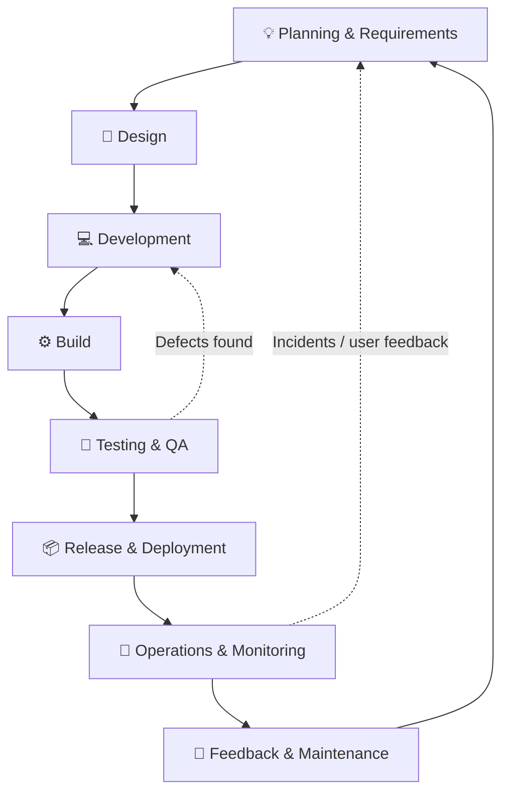
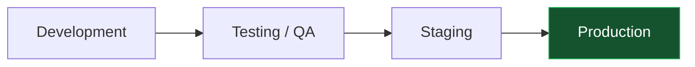
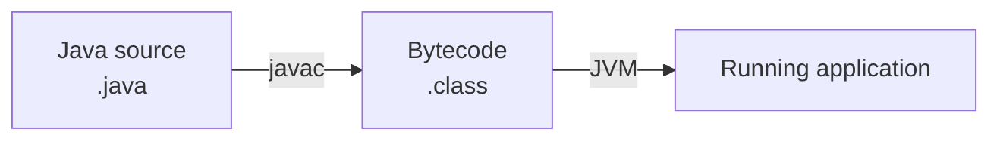
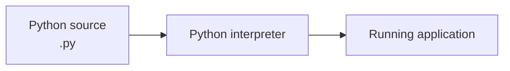
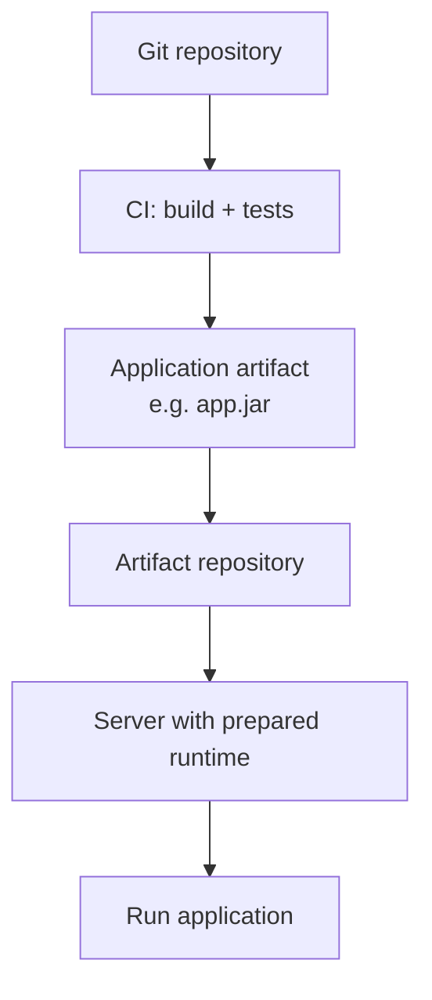
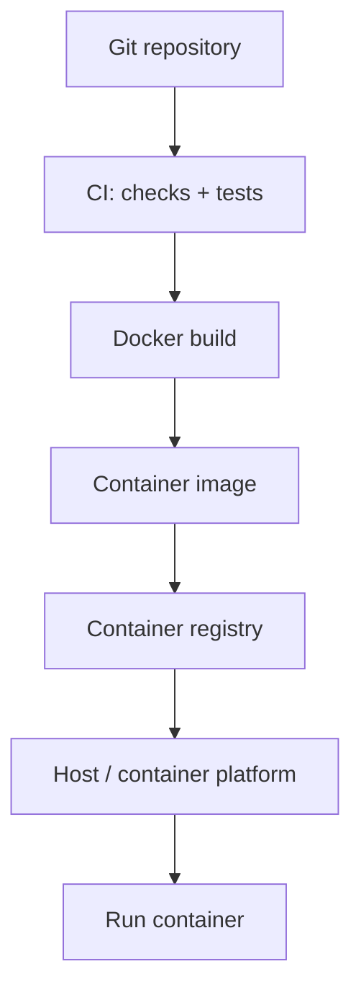
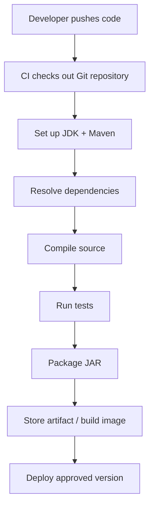
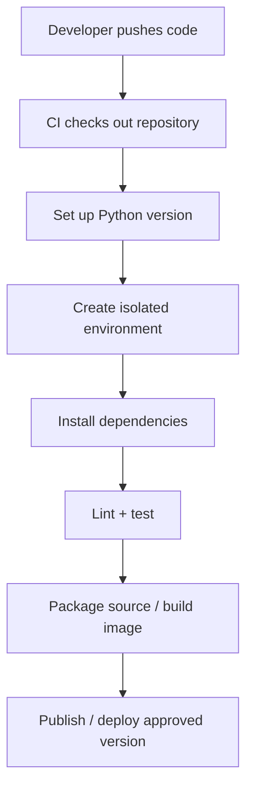
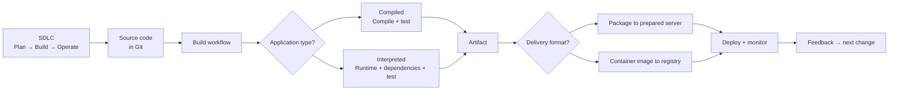

# Day 1 — Modern SDLC & Build Automation

<p align="center">
  <strong>From a software idea to a tested, deployable, and maintained product</strong><br/>
  <em>CI/CD Foundations · Revision Guide · Beginner to Practical</em>
</p>

<p align="center">
  <a href="https://www.youtube.com/watch?v=uHNOqKdqQas&t=455s">Modern SDLC</a> ·
  <a href="https://www.youtube.com/watch?v=uHNOqKdqQas&t=558s">SDLC Phases</a> ·
  <a href="https://www.youtube.com/watch?v=uHNOqKdqQas&t=2203s">Compiled vs Interpreted</a> ·
  <a href="https://www.youtube.com/watch?v=uHNOqKdqQas&t=2977s">Containerized Builds</a> ·
  <a href="https://www.youtube.com/watch?v=uHNOqKdqQas&t=3412s">Build Automation</a>
</p>

> [!NOTE]
> This guide follows all Day 1 topics and timestamps in the course outline shared for this repository. The outline contains chapter titles rather than a full transcript, so these are expanded study notes—not a word-for-word reconstruction of the instructor's explanations.

---

## What you'll understand after Day 1

| Concept | The question you should be able to answer |
| --- | --- |
| Modern SDLC | How does software move from an idea to a maintained product? |
| SDLC phases | What happens at each stage, and what does it produce? |
| Compiled vs. interpreted | How does the application's language affect its build workflow? |
| Containerized vs. non-containerized | What exactly gets delivered to the server? |
| Build automation | Why should build and test steps be repeatable? |

## Contents

- [1. Modern SDLC](#1-modern-sdlc)
- [2. SDLC phases: the complete lifecycle](#2-sdlc-phases-the-complete-lifecycle)
- [3. Compiled vs. interpreted languages](#3-compiled-vs-interpreted-languages)
- [4. Containerized vs. non-containerized workflows](#4-containerized-vs-non-containerized-workflows)
- [5. CI/CD workflow for compiled applications](#5-cicd-workflow-for-compiled-applications)
- [6. CI/CD workflow for interpreted applications](#6-cicd-workflow-for-interpreted-applications)
- [7. Why build automation matters](#7-why-build-automation-matters)
- [8. How the concepts connect](#8-how-the-concepts-connect)
- [9. Revision notes and interview answer](#9-revision-notes-and-interview-answer)
- [10. Self-check questions](#10-self-check-questions)

---

## 1. Modern SDLC

<sub>Course timestamp: [00:07:35 — Modern SDLC Explained](https://www.youtube.com/watch?v=uHNOqKdqQas&t=455s)</sub>

### What is SDLC?

**SDLC (Software Development Life Cycle)** is the structured process a team follows to plan, design, develop, build, test, release, operate, and improve software.

Think of an online shopping application. It begins as an idea—customers need to track their orders—and eventually becomes a feature that customers use. SDLC describes the work involved in that entire journey, including the improvements made after release.

### Why do teams need it?

Without a defined lifecycle, teams can:
- Build features that do not solve the user's actual problem.
- Work with unclear or changing requirements.
- Discover defects very late.
- Make inconsistent releases through manual hand-offs.
- Struggle to understand who owns an issue after deployment.
- Find maintenance difficult because decisions and processes were not planned.

A well-managed SDLC helps teams coordinate, control risk, maintain quality, and deliver useful software.

### Traditional delivery vs. modern delivery

In a traditional hand-off model, development, testing, and operations may work separately. A team completes its stage and passes the work to the next team. Feedback can arrive late, making problems expensive to fix.

Modern delivery aims for:
- Smaller and more frequent changes.
- Collaboration across development, testing, and operations.
- Automated checks and repeatable processes.
- Faster feedback from tests, monitoring, and users.
- Continuous improvement rather than treating release as the end.

**Agile and DevOps are related, but not interchangeable:**

| Agile | DevOps |
| --- | --- |
| Focuses on how teams plan and deliver work incrementally | Focuses on collaboration and shared responsibility across development and operations |
| Uses short feedback-driven iterations | Connects development, delivery, deployment, and operations |
| Helps teams adapt to changing requirements | Helps teams deliver and operate software reliably |

Neither Agile nor DevOps is a single tool. Automation supports the practices; it does not replace the culture or engineering decisions.

---

## 2. SDLC phases: the complete lifecycle

<sub>Course timestamp: [00:09:18 — SDLC Phases Explained](https://www.youtube.com/watch?v=uHNOqKdqQas&t=558s)</sub>

The names and boundaries can vary between organizations, but a typical lifecycle includes the following stages.

### The lifecycle at a glance



### What happens in each phase?

| Phase | What the team does | Typical output |
| --- | --- | --- |
| **1. Planning & requirements** | Understand the problem, users, scope, constraints, and acceptance criteria | Requirements, user stories, prioritized backlog |
| **2. Design** | Plan architecture, components, APIs, data model, UX, security, and infrastructure | Architecture and technical designs |
| **3. Development** | Write code, use version control, review changes, and collaborate | Source code in Git |
| **4. Build** | Resolve dependencies, compile or prepare code, package the application | JAR, binary, ZIP, or container image |
| **5. Testing & QA** | Verify correctness, integration, user workflows, performance, and security | Test results and quality reports |
| **6. Release & deployment** | Approve a version and make it available in an environment | A deployed application version |
| **7. Operations & monitoring** | Run the application and observe its health and behavior | Logs, metrics, traces, alerts |
| **8. Maintenance & feedback** | Fix defects, patch dependencies, improve performance, and add features | New requirements and changes |

### Environments: where does the application go?



- **Development:** developers integrate and check ongoing work.
- **Testing / QA:** the team verifies behavior and catches defects.
- **Staging:** a production-like environment for final validation.
- **Production:** the live environment used by customers.

Not every organization uses all four environments, and the promotion rules differ. The important idea is that a change should be validated before it reaches real users.

### Testing is not one single activity

| Test type | What it checks |
| --- | --- |
| Unit | A small function or component in isolation |
| Integration | Whether connected components work together |
| System / end-to-end | Whether a complete workflow behaves correctly |
| Acceptance | Whether the software meets agreed requirements |
| Performance | Response time, throughput, and behavior under load |
| Security | Vulnerabilities and insecure behavior |

**Remember:** SDLC is broader than coding. It includes planning before development and operating and maintaining the product after deployment.

---

## 3. Compiled vs. interpreted languages

<sub>Course timestamp: [00:36:43 — Compiled vs Interpreted Languages](https://www.youtube.com/watch?v=uHNOqKdqQas&t=2203s)</sub>

This distinction affects what happens during a CI build. Different languages produce and run application code in different ways.

### Compiled-language example: Java

A compiler translates source code into another form before execution. Depending on the language and platform, the result may be native machine code, bytecode, or another intermediate representation.



- C and C++ commonly compile to native binaries.
- Java compiles source code into JVM bytecode, which is executed by a Java Virtual Machine.

**Important:** Compiled does not always mean one native executable. Java normally produces bytecode and needs a compatible JVM.

### Interpreted-language example: Python

An interpreted-language workflow commonly runs source code using an interpreter or runtime rather than producing a standalone native executable ahead of time.



Python is commonly taught as an interpreted language. JavaScript is commonly run by a runtime such as Node.js.

**A useful nuance:** This is an introductory distinction, not an absolute description of every runtime. Some runtimes use bytecode and just-in-time compilation internally.

### Comparison

| Area | Compiled-language example | Interpreted-language example |
| --- | --- | --- |
| Examples | Java, C, C++ | Python, JavaScript |
| Typical CI work | Compile source, test, package | Set up runtime, install dependencies, test, package |
| Possible output | Binary, bytecode, package, image | Source bundle, package, image |
| Runtime | May need a runtime such as JVM | Needs the appropriate interpreter/runtime |

Both types still need automated testing, packaging, versioning, and deployment. The pipeline steps differ; the need for a pipeline does not.

---

## 4. Containerized vs. non-containerized workflows

<sub>Course timestamp: [00:49:37 — Build Workflows](https://www.youtube.com/watch?v=uHNOqKdqQas&t=2977s)</sub>

First, understand the term **build artifact**: an output created by the build process that can be stored, tested, distributed, or deployed. Examples include a JAR, executable, ZIP package, or container image.

### Non-containerized delivery

The application package is delivered to a server. The server must already have—or be configured with—the correct runtime, libraries, and other dependencies.



**Benefits**
- No container platform is required for a simple deployment.
- Can be straightforward when the target server environment is well managed.
- The application package may be smaller than a full image.

**Trade-offs**
- The target server's runtime and dependencies must be managed separately.
- Differences between environments can cause “works on my machine” problems.
- Server configuration becomes an important part of deployment consistency.

### Containerized delivery

A container image packages the application and its required user-space dependencies. It is built using a Dockerfile and distributed through a container registry.



**Benefits**
- The same image can be promoted through testing, staging, and production.
- Application runtime dependencies can be packaged with the app.
- Images fit naturally into container platforms and repeatable deployments.

**Trade-offs**
- Teams must manage image size, vulnerabilities, registries, networking, storage, and runtime configuration.
- Secrets and environment-specific configuration should not be baked into an image.
- Containers share the host kernel; they are not full virtual machines.

### Side-by-side view

| Concern | Non-containerized | Containerized |
| --- | --- | --- |
| Deployment unit | Application artifact | Container image |
| Runtime | Prepared on target server | Packaged in image where appropriate |
| Consistency | Depends heavily on server configuration | Image standardizes user-space dependencies |
| Distribution | Artifact repository / package storage | Container registry |
| Operations | Manage host runtime and app process | Manage host, container runtime, and containers |

> **Core takeaway:** Containers do not remove the build and test process. They change how the application and its dependencies are packaged and delivered.

---

## 5. CI/CD workflow for compiled applications

<sub>Course timestamp: [00:50:18 — Compiled Languages: CI/CD Build Workflow](https://www.youtube.com/watch?v=uHNOqKdqQas&t=3018s)</sub>

A compiled project needs a build environment with the correct compiler, build tool, and dependencies.

### Example: Java + Maven



Common Maven commands:

```bash
mvn compile
mvn test
mvn package
```

A common combined CI command:

```bash
mvn clean verify
```

- `clean` removes output from a previous build.
- `verify` runs the Maven lifecycle through the verification phase, including earlier phases such as compilation and tests when configured.

A successful compile alone does not prove that the application is correct. Tests and other quality checks are still needed. Maven's lifecycle and plugins are covered in a later course section.

---

## 6. CI/CD workflow for interpreted applications

<sub>Course timestamp: [00:53:29 — Interpreted Languages: CI/CD Build Workflow](https://www.youtube.com/watch?v=uHNOqKdqQas&t=3209s)</sub>

An interpreted-language project still needs a repeatable CI process, even if there is no traditional compile-to-native-binary step.

### Example: Python



Illustrative commands for a simple Python project:

```bash
python -m venv .venv
source .venv/bin/activate
python -m pip install -r requirements.txt
python -m pytest
```

A real project may use Poetry, uv, Pipenv, another test runner, or a containerized build environment.

**The important difference:** CI often focuses on selecting the right runtime, installing pinned dependencies, checking code quality, and running tests. The application can then be shipped as source plus dependencies or as a container image.

No traditional compile step does **not** mean no build process. Dependency resolution, validation, packaging, and artifact creation are still part of reliable delivery.

---

## 7. Why build automation matters

<sub>Course timestamp: [00:56:52 — Why Build Automation Tools Matter](https://www.youtube.com/watch?v=uHNOqKdqQas&t=3412s)</sub>

**Build automation** means using tools and repeatable instructions to perform build tasks consistently instead of asking developers to execute every step manually.

### Manual process vs. automated process

```mermaid
flowchart TB
    subgraph Manual["Manual delivery"]
      M1["Developer pulls code"] --> M2["Runs build commands"]
      M2 --> M3["Runs tests"]
      M3 --> M4["Packages application"]
      M4 --> M5["Uploads / deploys manually"]
    end
    subgraph Automated["Automated delivery"]
      A1["Developer pushes code"] --> A2["CI detects change"]
      A2 --> A3["Pipeline builds + tests"]
      A3 --> A4["Artifact is published"]
      A4 --> A5["Deploy or wait for approval"]
    end
```



### Why teams automate

| Benefit | What it means in practice |
| --- | --- |
| **Consistency** | The same defined steps run each time |
| **Speed** | Repeated manual work is reduced |
| **Early feedback** | Developers find build and test failures sooner |
| **Repeatability** | The process can be run again and investigated |
| **Fewer manual errors** | Steps are less likely to be skipped or run in the wrong order |
| **Collaboration** | Teams share a common delivery process |
| **Traceability** | Logs, reports, versions, and commit IDs show what happened |

### Know the role of each tool

| Tool | Typical responsibility |
| --- | --- |
| **Maven** | Java build lifecycle and dependency management |
| **Gradle** | Build automation and dependency management |
| **npm scripts** | Run project-defined JavaScript tasks |
| **Make** | Automate command-based build tasks |
| **Jenkins** | Orchestrate build, test, and delivery workflows by invoking other tools |

**Do not mix these roles up:** Maven and Gradle perform project build tasks. Jenkins is an automation server that can coordinate those tools as part of a wider pipeline. Jenkins does not replace every language-specific build tool.

Automation also does not mean every code change must go straight to production. Teams can add approval gates, release policies, and environment checks.

---

## 8. How the concepts connect

This is the big picture of Day 1: SDLC describes the whole product lifecycle; build workflows explain how code becomes a deliverable; automation makes those steps repeatable.



### Where does Jenkins fit?

Jenkins can automate and coordinate the steps shown above: checking out code, invoking Maven or another build tool, running tests, building a Docker image, publishing an artifact, and triggering deployment. The later course days will explore how Jenkins jobs and pipelines implement this.

---

## 9. Revision notes and interview answer

### Seven points to remember

1. **SDLC** covers the complete software journey—from planning through maintenance.
2. **Modern delivery** emphasizes collaboration, smaller changes, automation, and fast feedback.
3. **Compiled and interpreted applications** have different build details, but both need repeatable validation and delivery.
4. **A build artifact** is the output that can be stored, distributed, or deployed.
5. **Non-containerized delivery** sends an application package to a server whose runtime must be prepared.
6. **Containerized delivery** sends an image containing the application and its user-space dependencies.
7. **Build tools and Jenkins have different roles:** build tools perform project tasks; Jenkins orchestrates the wider workflow.

### A concise answer you can say aloud

> “The Software Development Life Cycle is the complete process of building and maintaining software. It starts with planning and requirements, then design, development, build, testing, release, deployment, operations, monitoring, and maintenance. Modern teams use Agile and DevOps practices to improve collaboration and shorten feedback loops.
>
> In CI/CD, the build process depends on the application's technology. A compiled project such as Java may compile source into bytecode and package it as a JAR. An interpreted project such as Python usually sets up the runtime, installs dependencies, and runs checks before packaging or deployment.
>
> An application can be delivered as a normal artifact to a prepared server or as a container image. Containers help make the application environment more consistent across stages. Build automation makes tasks such as dependency installation, compilation, testing, and packaging repeatable. Jenkins can orchestrate these tools in a pipeline.”

Use this as a framework, not a script to memorize. Practice explaining each diagram in your own words.

---

## 10. Self-check questions

Try answering these without looking at the guide.

<details>
<summary><strong>1. What is SDLC, and why is it broader than coding?</strong></summary>

SDLC is the complete lifecycle of software: planning, design, development, build, testing, release, operations, and maintenance. Coding is only one phase.
</details>

<details>
<summary><strong>2. What is the difference between Agile and DevOps?</strong></summary>

Agile organizes work into incremental, feedback-driven delivery. DevOps emphasizes collaboration and shared responsibility between development and operations.
</details>

<details>
<summary><strong>3. What is a build artifact?</strong></summary>

A produced output that can be stored, distributed, tested, or deployed—for example, a JAR, executable, ZIP package, or container image.
</details>

<details>
<summary><strong>4. Why does a Python project still need CI?</strong></summary>

It still needs a known runtime, dependency installation, linting, tests, packaging, and repeatable delivery even if it has no traditional compile-to-native-binary step.
</details>

<details>
<summary><strong>5. What changes when an application is containerized?</strong></summary>

The deployment unit becomes a container image that packages the app and user-space dependencies. The image can be stored in a registry and run on a compatible container platform.
</details>

<details>
<summary><strong>6. Why should secrets not be baked into an image?</strong></summary>

Images may be shared across environments and stored in registries. Secrets should be supplied securely at runtime so they are not exposed in image layers or metadata.
</details>

<details>
<summary><strong>7. How is Jenkins different from Maven?</strong></summary>

Maven manages a project's build lifecycle and dependencies. Jenkins orchestrates broader automation workflows and can invoke Maven as one pipeline step.
</details>

---

## Day 1 completion checklist

- [x] Course introduction
- [x] Modern SDLC explained
- [x] SDLC phases — end-to-end view
- [x] Compiled vs. interpreted languages
- [x] Containerized vs. non-containerized build workflows
- [x] Compiled-language CI/CD workflow
- [x] Interpreted-language CI/CD workflow
- [x] Why build automation tools matter
- [x] Day 1 wrap-up

---

<p align="center">
  <strong>Day 1 complete · Next: Day 2 — CI/CD Concepts & Branching Strategies</strong><br/>
  <a href="../02-CI-CD-and-Branching-Strategies/">Continue to Day 2</a> ·
  <a href="../Course-Outline.md">Full course outline</a>
</p>
