# Day 2 — CI/CD Explained: How Pipelines Work & Branching Strategies

> Beginner-friendly notes based on Day 2 of **Jenkins: Basics to Production** by Josh (Cloud with Josh / Precode Camp). Explanations and diagrams are written as a learning companion, not a video transcript.

**Video:** [Watch Day 2 — CI/CD Explained](https://www.youtube.com/watch?v=szPE1NKc614)  
**Focus:** Git, branches, CI/CD practices, GitFlow, trunk-based development, artifact promotion, and Jenkins.

---

## Learning objectives

By the end of this guide, you should be able to:

- Explain Git, commits, branches, remotes, pull requests, and protected branches.
- Understand CI, Continuous Testing, Continuous Delivery, Continuous Deployment, and Continuous Monitoring.
- Explain how a code change moves from a developer's laptop to production.
- Compare GitFlow and trunk-based development.
- Explain why teams build an artifact once and promote the same immutable artifact.
- Describe Jenkins' role in the workflow.

## 1. Start with a real-life scenario

Imagine a company building an online banking application. A developer is asked to add a feature that lets customers repay a loan.

The developer should not directly change the live application. Instead, the developer writes the feature on a separate Git branch, shares it for review, and lets automated systems check it. Once the change is accepted, the application is packaged and moved through test environments before reaching customers.

That is the problem Git and CI/CD help solve:

- **Git** tracks the source-code changes.
- **A Git hosting platform** lets the team collaborate.
- **CI** checks whether the proposed code change works.
- **CD** helps deliver the verified application to environments.
- **Jenkins** can automate and coordinate these steps.
- **Monitoring** helps the team understand how the live application behaves.

## 2. Git and branching: the foundation

### 2.1 What is Git?

**Git is a distributed version control system (DVCS).** It records changes to files over time so developers can collaborate, inspect history, and return to earlier versions when needed.

It is distributed because each developer can have a local copy of the repository and its history. Developers can commit and create branches locally, even without an internet connection, then synchronize with a shared remote repository.

**Real-life analogy:** Think of a group assignment. Each person keeps a copy of the project, records their own changes, and later shares those changes with the group. Git does this in a controlled, traceable way.

Important terms:

| Term | Simple meaning |
| --- | --- |
| Repository (repo) | The project and its tracked history |
| Commit | A saved snapshot of changes, identified by a unique SHA |
| Push | Send local commits to a remote repository |
| Pull | Bring remote changes into your local branch |
| Clone | Copy a remote repository to your computer |
| Tag | A human-friendly label for a particular commit, often used for releases |
| Fork | Your own GitHub copy of another person's repository |
| Merge | Combine changes from different lines of work |
| Rebase | Replay commits on top of a different base; it rewrites commit history |

A commit SHA identifies a particular commit. For example, `9f3c2e7` is a shortened-looking example, not a real commit from this project.

### 2.2 Local repository and remote hosting

Git is the version-control tool. GitHub, GitLab, and Bitbucket are hosting platforms where teams can store remote repositories, review changes, manage permissions, and connect automation.

Other options mentioned in the lesson include Azure Repos and self-hosted platforms such as Gitea and Gerrit.

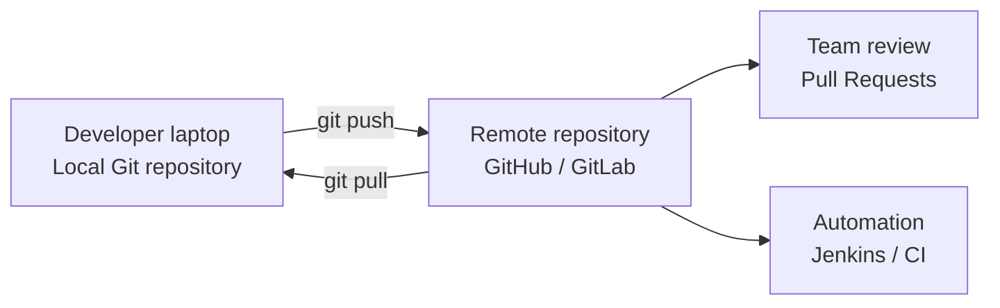

**Remember:** Git manages version history. GitHub hosts the shared repository and collaboration features. Jenkins can react to repository events and run automation; it is not a replacement for GitHub.

### 2.3 What is a branch?

A **branch** is a lightweight, movable pointer to a line of development. It allows developers to work on changes separately without immediately changing the main code line.

Common branch names:

- `main`: the main source-of-truth branch.
- `feature/loan-repayment`: a short-lived branch for a new feature.
- `dev`, `stage`, `prod`: environment/release branches in a GitFlow-style workflow.
- `release/1.4.3`: a branch used to stabilize a particular release.

**Analogy:** In a group assignment, imagine making a separate copy before editing a chapter. You can work on your chapter without disturbing everyone else's work. When it is ready, you propose combining it with the main document.

### 2.4 What is a Pull Request (PR) or Merge Request (MR)?

A **Pull Request (PR)** is a proposal to merge changes from one branch into another. GitLab commonly calls the same concept a **Merge Request (MR)**.

A PR gives teammates a place to:

1. Inspect the proposed code changes.
2. Ask questions and request improvements.
3. Review and approve the work.
4. See automated build, test, and security-check results.
5. Decide whether the change can be merged.

For example, a developer creates `feature/loan-repayment` and opens a PR targeting `dev`. The PR does not mean the change has already entered `dev`; it is a proposal.

**Green checks** mean the configured automated checks passed. **Red checks** mean one or more checks failed. A protected branch can require green checks before allowing the merge.

### 2.5 Protected branches and status checks

Important branches such as `main`, `stage`, and `prod` should be protected with repository rules.

Typical protections include:

- **PRs only:** block direct pushes to important branches.
- **Required reviews:** require one or more approvals before merging.
- **Required status checks:** build, unit tests, linting, and security checks must pass.
- **Up-to-date with base:** the PR must include the latest changes from its target branch before merging.

Example: A PR into production requires two approvals and passing build, test, and security checks. If the security check fails, the merge stays blocked until the issue is fixed and the checks run again.

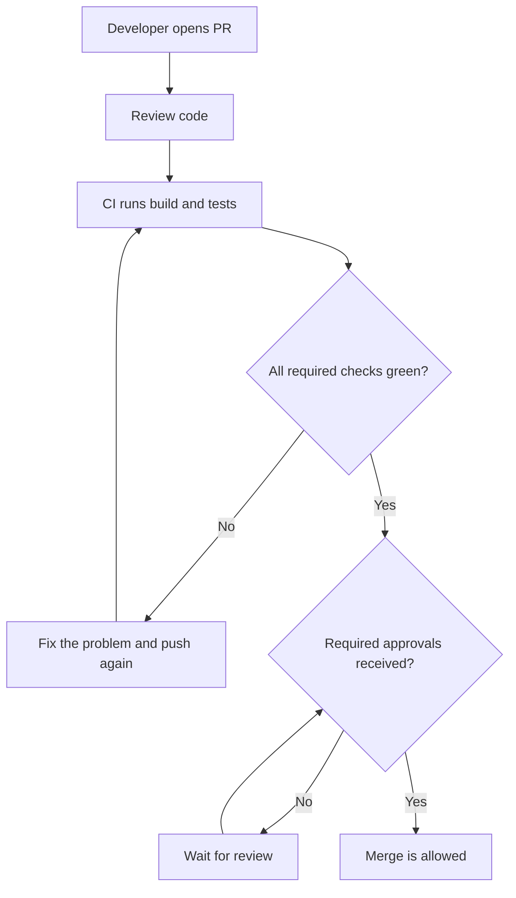

### 2.6 How Git fits into CI/CD

Think of the responsibilities as a chain:

- **Git** records source-code changes.
- **PRs** provide a review and merge decision point.
- **CI** automatically validates proposed changes.
- **CD** delivers a verified artifact to the next environment.

Git stores the source code and its history. The pipeline checks and delivers the software built from that source.

---

## 3. The continuous practices in DevOps

CI/CD is often used as a general term for automated software integration and delivery. The lesson also introduces Continuous Testing and Continuous Monitoring.

### 3.1 Continuous Integration (CI)

**CI means automatically building and checking code changes frequently**, usually when a developer pushes commits or opens/updates a PR.

A typical CI job:

1. Checks out the exact source-code revision.
2. Installs dependencies.
3. Builds or compiles the application.
4. Runs unit tests.
5. Runs quick quality and security checks.
6. Reports a pass/fail status to the Git platform.

**Example:** A developer changes the loan repayment calculation. Jenkins checks out the PR's code, builds the application, and runs unit tests. If a test fails, the PR receives a red status and the team fixes the problem before merging.

CI should provide quick feedback. The lesson suggests keeping the fast PR checks around 10–15 minutes where practical.

Common tools include Jenkins, GitHub Actions, and GitLab CI.

### 3.2 Continuous Testing (CT)

**Continuous Testing means testing throughout the software delivery lifecycle**, not only during the initial build.

CI normally runs a fast subset of tests. Continuous Testing is the wider safety net and can include:

- Unit tests: does a small piece of code behave correctly?
- Integration tests: do different components work together?
- API/UI end-to-end tests: can a user complete an important journey?
- Performance tests: does the application respond under load?
- Security tests: can we identify vulnerabilities?
- Smoke tests: does the deployed application basically work?

**Example:** A loan repayment unit test checks the calculation. An integration test checks whether the repayment service can communicate with the database. A smoke test checks whether the deployed service is healthy.

Tools mentioned in the lesson: JUnit, TestNG, Cypress, Playwright, Postman/Newman, JMeter, k6, and OWASP ZAP.

### 3.3 Continuous Delivery (CD)

**Continuous Delivery keeps software in a deployable state.** The pipeline can automatically build, test, package, and deliver the application to non-production environments. A human approval is commonly required before production deployment.

**Example:** Every approved change is built and deployed to Dev, then tested in Stage. When the team is satisfied, an authorized person approves the production release.

The important idea is that a release is ready to ship, even if a human still decides when it goes to production.

### 3.4 Continuous Deployment (CDp)

**Continuous Deployment automatically releases changes to production** after the required checks pass. There is no manual production approval step in the normal successful path.

Because real users are affected, teams use safety measures such as canary releases, blue-green deployments, feature flags, health checks, and automatic rollback.

**Example:** A small change passes all required tests. The pipeline deploys it to a small percentage of production traffic first. If health indicators remain good, it gradually reaches more users.

### 3.5 Continuous Monitoring (CM)

**Continuous Monitoring means continuously observing the application and infrastructure after deployment.**

The lesson highlights three observability signals:

- **Metrics:** numerical measurements, such as request rate, CPU usage, and error rate.
- **Logs:** records of events that happened in the application or system.
- **Traces:** the path of a request as it travels through multiple services.

Signals become useful when teams apply dashboards, alerts, and Service Level Objectives (SLOs) to them.

**Example:** After releasing a loan repayment feature, monitoring shows that API latency has increased. An alert informs the team, engineers investigate the logs and traces, and the findings can lead to a fix or rollback.

Tools mentioned: Prometheus, Grafana, Elastic Stack (ELK), Datadog, and New Relic.

### 3.6 Compare the five practices

| Practice | Main question | Main purpose |
| --- | --- | --- |
| CI | Does this code change build and pass fast checks? | Validate changes and gate merges |
| CT | Have we tested the software sufficiently across the lifecycle? | Broader testing and confidence |
| CD | Is the verified release ready to deploy? | Keep releases deployable; often use approval for production |
| CDp | Can a passing change go to production automatically? | Automatically release to production |
| CM | Is the running system healthy? | Observe, alert, and feed learning back into delivery |

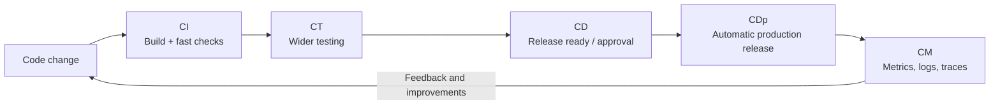

**Easy memory trick:**

- CI checks the change.
- CT widens the testing.
- CD keeps the release ready.
- CDp deploys to production automatically.
- CM watches the running system.

> Terminology note: In everyday conversations, “CD” can mean Continuous Delivery or Continuous Deployment. In these notes, **CD** means Continuous Delivery and **CDp** means Continuous Deployment, following the lesson's distinction.

---

## 4. What is a CI/CD pipeline?

A **pipeline** is an automated, repeatable sequence of steps used to build, test, package, publish, and sometimes deploy software.

A basic pipeline might look like this:

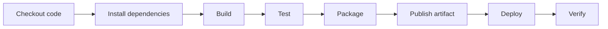

A pipeline is useful because the same defined steps can run consistently whenever the relevant event occurs. Instead of manually repeating every step, the team automates the process.

For example, a push or PR can trigger Jenkins through a webhook. Jenkins then runs the pipeline and reports the result.

---

## 5. Branching strategies: GitFlow vs trunk-based development

A **branching strategy** is a team's agreed way of using Git branches to integrate changes and release software.

The lesson focuses on two approaches. Both can use CI and both should follow the principle of building once and promoting the same artifact.

### 5.1 GitFlow-style environment branches

In the simplified environment-branch model, separate long-lived branches represent environments:

- `dev`
- `stage`
- `prod`

Feature branches are merged into `dev). A promotion PR then proposes moving the release candidate from `dev` to `stage`, and another promotion PR moves it from `stage` to `prod`.

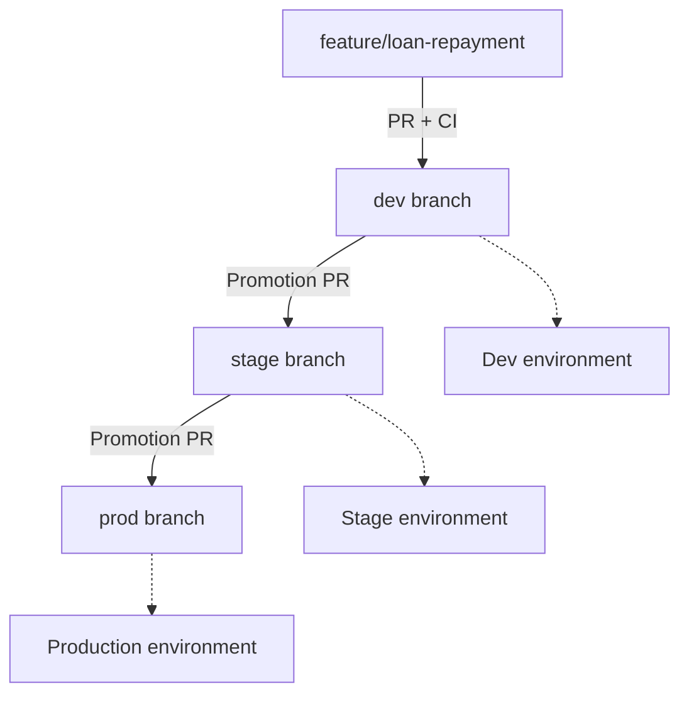

**Walkthrough:**

1. Developer commits and pushes changes to a feature branch.
2. Developer opens a PR from the feature branch into `dev`.
3. CI checks the proposed merge result, including build and tests.
4. Green checks and required reviews allow the PR to merge; red checks block it.
5. After merge, the Dev environment can be automatically updated.
6. When the release is ready, a promotion PR proposes `dev → stage`.
7. The Stage promotion pipeline validates, deploys, and tests the release candidate.
8. If all required checks and approvals pass, the promotion PR can merge.
9. A similar, more strictly controlled promotion takes the release from Stage to Production.

**Advantages:**

- Easy to visualize how a release moves between environments.
- Clear review and approval points.
- Useful audit trail for controlled release processes.

**Trade-offs:**

- More branches and PRs to maintain.
- More merge coordination.
- Long-lived branches can drift apart and develop conflicts.

The lesson notes that this approach is often seen in regulated/enterprise environments and release-train setups.

### 5.2 Trunk-based development

In trunk-based development, **`main` is the single long-lived source of truth**. Developers work on short-lived feature branches and open small PRs into `main`.

There are no separate long-lived `dev`, `stage`, and `prod` application-code branches in this model. Instead, the same built artifact is promoted through the environments using pipeline stages or environment-configuration/GitOps changes.

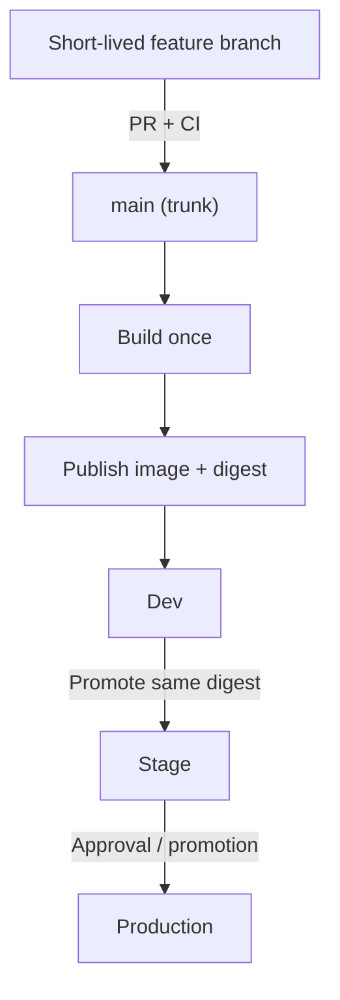

**Walkthrough:**

1. Developer creates a short-lived feature branch.
2. Developer opens a PR into `main`.
3. CI tests the tentative merge result without changing `main`.
4. Passing checks and required reviews allow the PR to merge.
5. A post-merge pipeline builds the application once and publishes an artifact.
6. The pipeline records the artifact's immutable digest and release metadata.
7. The same artifact is deployed to Dev, then promoted to Stage.
8. Stage runs deeper tests.
9. Production deployment follows the required approval or automatic-deployment policy and a guarded rollout.

**Advantages:**

- Fewer long-lived branches and less merge overhead.
- Small changes can receive fast feedback.
- Fits teams that release frequently, including many SaaS and microservices teams.

**Trade-offs:**

- Requires disciplined small PRs and reliable automated tests.
- Teams need good release controls, feature flags, and rollback practices.

### 5.3 Side-by-side comparison

| Topic | GitFlow-style environment branches | Trunk-based development |
| --- | --- | --- |
| Long-lived branches | `dev`, `stage`, `prod` | Mainly `main` |
| Feature work | Feature branches | Short-lived feature branches |
| Environment promotion | PRs between environment branches | Pipeline or GitOps/config promotion |
| Main strength | Explicit, auditable promotion steps | Faster integration, fewer long-lived branches |
| Main challenge | Branch drift and merge overhead | Requires strong testing and small changes |

**Critical point:** The branching strategy changes how code is organized and how promotions are represented. It should not change the artifact policy: **build once, promote the same artifact.**

Other workflows mentioned in the lesson:

- **GitHub Flow:** lightweight `main` plus short feature branches.
- **Release branching / release trains:** a release branch is stabilized while development continues elsewhere.
- **Forking workflow:** contributors work in personal forks and submit PRs back.
- **Monorepo variants:** multiple components live in one repository, often with trunk-based practices and ownership rules.

---

## 6. Artifact promotion: build once, promote the same digest

This is one of the most important ideas in the lesson.

### 6.1 What is an artifact?

An **artifact** is the output produced by a build that can be stored and later deployed. Examples include a Docker image, a JAR package, or another versioned application package.

Imagine building the loan application Docker image. You want the exact same image tested in Dev to be the image that is tested in Stage and released to Production.

You do not want to rebuild separately for each environment because each rebuild could produce a different result.

### 6.2 What is an image tag?

A tag is a human-friendly name for an image, such as:

- `v1.4.3` — release version.
- `9f3c2e7` — source commit identifier.
- `9f3c2e7-v1.4.3` — combined label.

Tags help people recognize an image. However, tags can be moved or reused depending on registry policy.

### 6.3 What is an image digest?

A **digest** is a content-addressed identifier for an image, commonly written like:

`sha256:abc123...`

The digest identifies the image content. Deploying by digest makes it clear which exact image is being used.

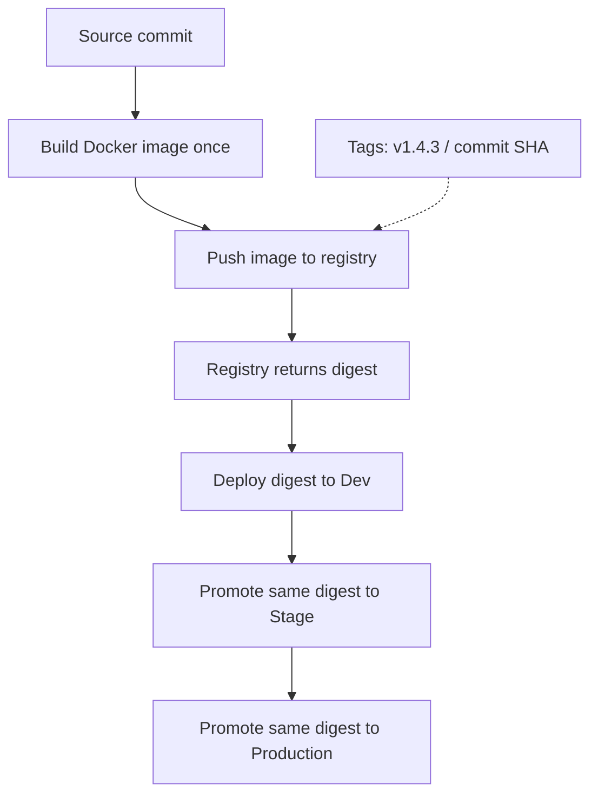

**The rule:**

- Build once.
- Publish the image.
- Record its digest.
- Use tags to help humans recognize it.
- Deploy the same digest in every environment.
- Change environment configuration, not the application artifact.

### 6.4 What is a promotion manifest?

A promotion manifest is a small metadata file that tells later deployment jobs which artifact to deploy and where it came from.

Example:

```json
{
  "image": "ghcr.io/acme/banking-loans",
  "digest": "sha256:abc123...",
  "version": "v1.4.3",
  "commit_sha": "9f3c2e7",
  "tags": ["v1.4.3", "9f3c2e7"],
  "built_at": "2025-09-15T10:22:00Z"
}
```

This is an illustrative example from the lesson's pattern, not a real image or deployment from this repository.

The manifest records:

- Image repository.
- Immutable digest.
- Release version.
- Source commit.
- Optional human-friendly tags.
- Build timestamp.

A later pipeline can read the manifest and deploy that digest without rebuilding the application.

---

## 7. GitFlow promotion in detail

### 7.1 Feature branch → dev: deploy after merge

A developer opens a PR from a feature branch into `dev`.

The CI pipeline tests the tentative merge result: the proposed combination of the feature and the target branch. The actual `dev` branch remains unchanged until the PR is merged.

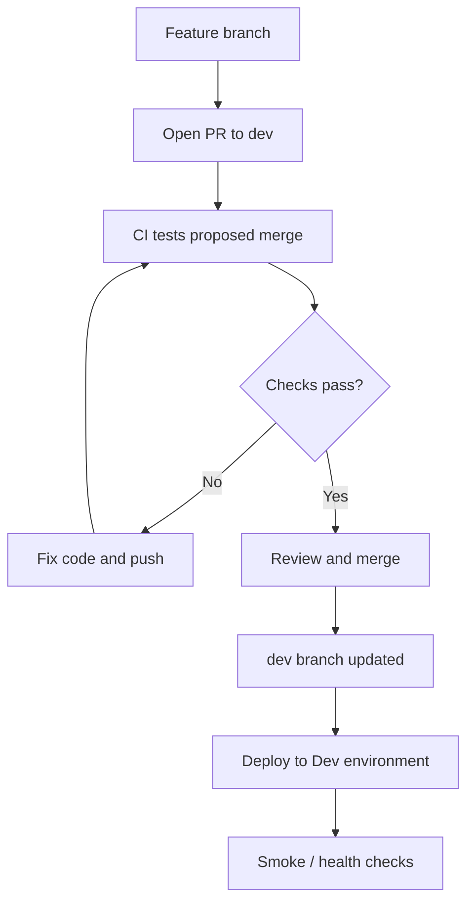

Why deploy Dev after the merge? Dev should represent the current `dev` branch. If every open PR deployed to the same shared Dev environment before merging, multiple PRs could overwrite each other's test deployments.

### 7.2 dev → stage: deploy before merge

Stage is a controlled promotion gate. The lesson describes a **deploy-before-merge** flow: the Stage promotion pipeline runs while the promotion PR is open. The PR is merged only after the exact candidate is deployed and Stage checks pass.

Before promotion:

1. Build one image from the approved source.
2. Push it to the registry.
3. Record its immutable digest.
4. Publish a manifest with image, digest, commit, and version.

The Stage PR should identify the exact candidate by digest. The pipeline must not rebuild it.

**Stage preflight checks:**

- Fetch and validate the promotion manifest.
- Verify that the digest can be pulled.
- Render and validate Stage configuration.
- Check that the required repository and environment rules are satisfied.

**Deploy:** use the same digest with Stage-specific configuration.

The lesson gives this illustrative command:

```bash
IMAGE=$(jq -r '.image' manifest.json)
DIGEST=$(jq -r '.digest' manifest.json)

helm upgrade --install loans ./charts/loans \
  --set image.repository="$IMAGE" \
  --set image.digest="$DIGEST" \
  -f charts/loans/values-stage.yaml
```

The chart should render the image as:

```text
image: <repository>@<digest>
```

**Post-deployment checks:**

- Health/readiness checks.
- A version endpoint that identifies the deployed version and commit.
- Small integration or end-to-end tests for important user journeys.

Example: test creating a loan and then retrieving it.

Typical required PR checks in the lesson:

- `preflight-manifest`
- `preflight-config`
- `deploy-to-stage`
- `stage-smoke`
- `stage-integration`

The PR also needs the required review and must be up to date with its target branch.

**If Stage succeeds:** the PR can merge, recording the promotion. No new build is needed.

**If Stage fails:** keep the PR unmerged, roll Stage back if needed, fix the issue in Dev, build a new artifact/digest, and promote the new candidate.

### 7.2.1 Visual walkthrough: a promotion PR from dev → stage

This is the detailed version of the flow shown in the lesson's diagram. Imagine **Acme Bank** is preparing release `v1.4.3` of its loan-repayment service. The feature has already been merged into `dev`, and the team wants to promote that exact release candidate into the shared Stage Kubernetes environment.

> **Important:** The values below (`ghcr.io/acme/banking-loans`, `v1.4.3`, commit `9f3c2e7`, and digest `sha256:abc123...`) are illustrative teaching values, not a real Acme Bank deployment.

#### The flow at a glance

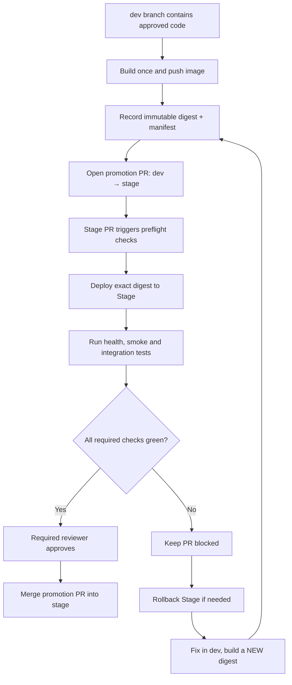

#### Step 1 — Build once in the dev release flow

When the approved code is ready, the build pipeline creates a container image and pushes it to the registry.

Example image tag:

```text
ghcr.io/acme/banking-loans:9f3c2e7-v1.4.3
```

The registry returns an immutable digest, for example:

```text
sha256:abc123...
```

A tag is a convenient label; the digest identifies the exact image content. The promotion pipeline must use the digest, not rebuild the source and not rely on a tag that could later be moved.

#### Step 2 — Publish a promotion manifest

The build pipeline writes metadata to `manifest.json`. The manifest is the hand-off note between the build stage and later deployment stages.

```json
{
  "image": "ghcr.io/acme/banking-loans",
  "digest": "sha256:abc123...",
  "version": "v1.4.3",
  "commit_sha": "9f3c2e7",
  "tags": ["v1.4.3", "9f3c2e7-v1.4.3"],
  "built_at": "2025-09-15T10:22:00Z"
}
```

Think of it like a shipping label attached to a sealed package. It records **what was built**, **which source commit produced it**, and **the exact package identity**. The Stage pipeline reads this file; it does not compile or rebuild the application.

#### Step 3 — Open a promotion PR

A release engineer opens a PR from `dev` to `stage`. This PR is a controlled request to promote release `v1.4.3`.

For this deploy-before-merge pattern, opening or updating the PR triggers the Stage promotion pipeline. The PR stays open while the candidate is tested in Stage. The `stage` branch is not updated just because the PR was opened.

#### Step 4 — Preflight checks (before deployment)

Before touching the Stage cluster, Jenkins performs checks such as:

| Check | What it protects against | Acme Bank example |
| --- | --- | --- |
| Manifest reachable | Missing or unavailable release metadata | Jenkins can download `manifest.json` |
| Digest pullable | Registry access or image publication problem | Kubernetes nodes can pull `@sha256:abc123...` |
| Configuration renders | Invalid environment-specific deployment settings | Helm can render the Stage values file |
| Dry-run validation | Invalid Kubernetes resources | The rendered Deployment passes server-side validation |

A simplified configuration check might look like:

```bash
helm template loans ./charts/loans \\
  --set image.repository="ghcr.io/acme/banking-loans" \\
  --set image.digest="sha256:abc123..." \\
  -f charts/loans/values-stage.yaml
```

A preflight failure stops the pipeline before the rollout. For example, if the manifest is missing or the digest cannot be pulled, Jenkins should not continue to deployment.

#### Step 5 — Deploy to Stage without rebuilding

The deployment job reads the image and digest from the manifest and applies Stage-specific configuration.

```bash
IMAGE=$(jq -r '.image' manifest.json)
DIGEST=$(jq -r '.digest' manifest.json)

helm upgrade --install loans ./charts/loans \\
  --set image.repository="$IMAGE" \\
  --set image.digest="$DIGEST" \\
  -f charts/loans/values-stage.yaml
```

The resulting container image reference should resolve to:

```text
ghcr.io/acme/banking-loans@sha256:abc123...
```

Notice the separation:

- **Application artifact:** the exact same image digest built earlier.
- **Environment configuration:** Stage values such as replica count, hostname, resource limits, and connection settings.

The application image is not rebuilt for Stage. Only the environment configuration changes.

#### Step 6 — Post-deployment checks

Now Acme Bank checks whether the deployed service actually works in the Stage environment.

| Check | What the team verifies | Example |
| --- | --- | --- |
| Readiness / health | The service is running and ready | Kubernetes readiness probe succeeds |
| Version endpoint | The expected release is running | `/version` reports `v1.4.3` and commit `9f3c2e7` |
| Smoke test | A critical path works at a basic level | Loan service health endpoint returns success |
| Small integration test | Important services communicate correctly | Create a test loan and retrieve it |

A green Kubernetes rollout alone is not enough: pods can be running while the application has a broken database connection or a failing business operation. That is why the pipeline also checks application-level behavior.

#### Step 7 — PR status decides whether merging is allowed

The lesson's Stage branch protection example requires the PR to satisfy all required checks, stay up to date with its base branch, and receive the required review.

Example required statuses:

- `preflight-manifest`
- `preflight-config`
- `deploy-to-stage`
- `stage-smoke`
- `stage-integration`

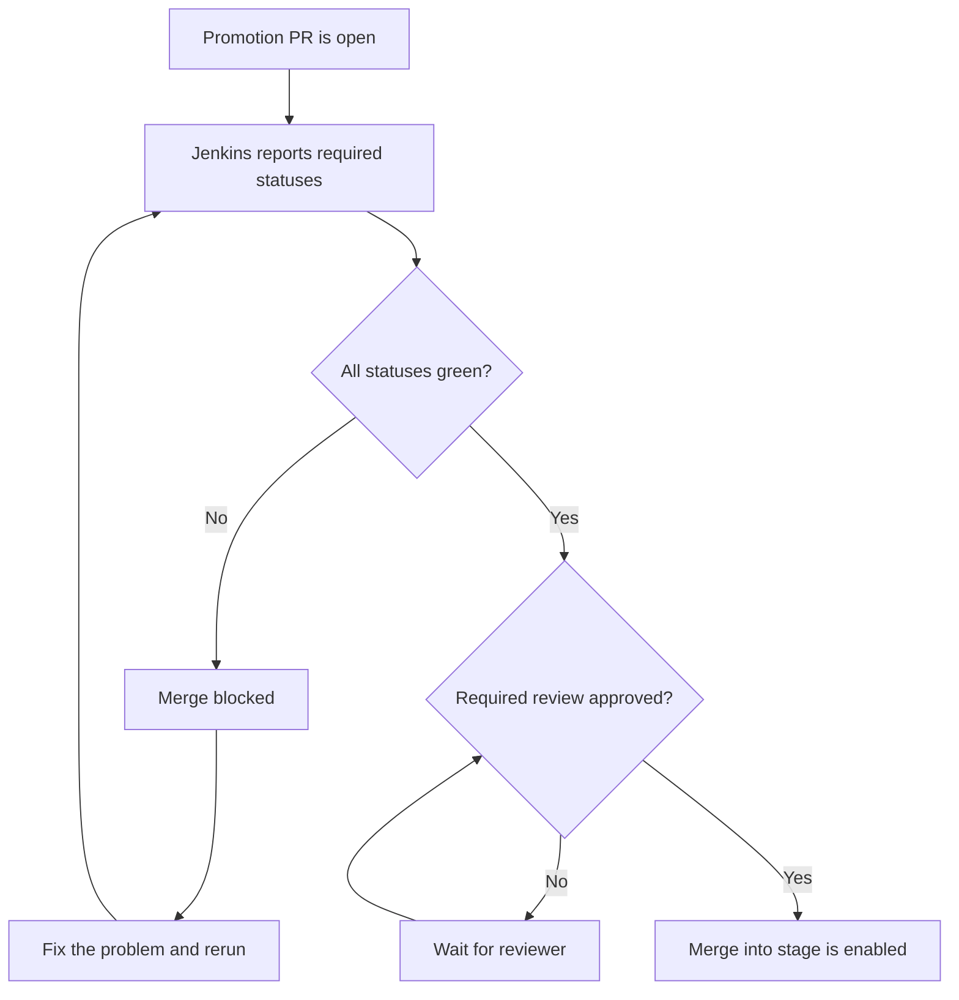

This is the key safety gate: **a successful deployment and passing Stage tests make the promotion eligible for merge; they do not silently bypass code review or branch protection.**

#### Step 8 — What if Stage fails?

Suppose the new loan-repayment service deploys, but the integration test finds that repayment records are not saved correctly.

1. The Stage integration status turns red.
2. The PR remains unmerged because a required status check failed.
3. The team investigates. If the Stage environment is now unhealthy, it rolls back to the last known-good release.
4. Developers fix the defect in the source branch / `dev`.
5. The build pipeline creates and publishes a **new** image.
6. The new digest is written to a new or updated promotion manifest.
7. The team re-runs the promotion process for that new digest.

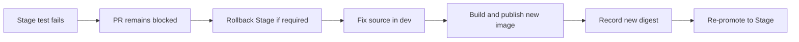

Do not patch the running Stage container manually and do not rebuild a different image only for Stage. Fix the source, produce a new versioned artifact, and promote that artifact through the normal gates.

#### What the screenshot's labels mean

| Diagram label | Plain-language meaning |
| --- | --- |
| **Promotion PR: dev → stage** | A reviewed request to move a release candidate from Dev to Stage |
| **Preflight** | Checks performed before changing the Stage environment |
| **Deploy (no rebuild)** | Install the already-built image by its recorded digest |
| **Post-deploy** | Verify the live Stage deployment and important user paths |
| **PR Status** | Jenkins reports whether each required pipeline check passed |
| **Green → Merge enabled** | Required checks and review are satisfied, so GitHub permits the merge |
| **Red → Merge blocked** | At least one required condition failed; the PR cannot be merged |
| **Fix in dev → new digest → re-promote** | Correct the source, create a new artifact, and repeat the controlled promotion |

**Remember this sequence:** build once → record digest → open promotion PR → preflight → deploy the same digest → test Stage → merge only when required checks and review pass.

---

### 7.3 stage → prod: the production gate

Production follows the same artifact-promotion principle but uses stricter safety rules.

Before deployment, the pipeline can verify:

- The manifest and digest are valid.
- The artifact is the one proven in Stage.
- Production configuration renders correctly.
- Required approvals and change windows are satisfied.
- Feature flags for new functionality default to OFF where appropriate.

The production rollout should be cautious. The lesson gives examples of:

- **Canary:** gradually send traffic to the new version, such as 5% → 20% → 50% → 100%.
- **Blue-green:** run old and new environments side by side, then switch traffic when ready.
- **Rollback:** return to the last known-good artifact if health indicators fail.

Production verification focuses on health and user impact, including error rate, latency, saturation, and short smoke/synthetic tests.

If everything is healthy and required approvals are present, merge the promotion PR and record the release. If something fails, roll back or disable the new feature, fix the source, create a new artifact, and repeat the promotion process.

### 7.4 Why Dev and Stage use different promotion timing

| Promotion | Timing | Reason |
| --- | --- | --- |
| Feature → dev | Merge first, deploy after | Dev should reflect the current dev branch; shared pre-merge deployments can conflict |
| dev → stage | Deploy and test during PR, merge after | Stage is a controlled release gate; merge only a proven promotion |
| stage → prod | Strict pre-deploy gates, guarded rollout, verify, then record promotion | Production affects real users and needs stronger controls |

**Analogy from the lesson:**

- Feature → Dev is like a daily team sync: integrate frequently and fix issues quickly.
- Dev → Stage/Production is like a dress rehearsal: test the release candidate before signing off.

---

## 8. Trunk-based promotions in detail

In trunk-based development, code is merged into `main`, and the same artifact is promoted through the environments.

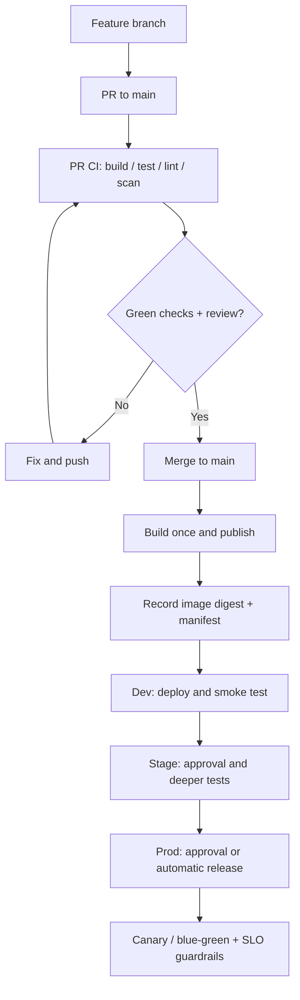

The sequence:

1. Commit and push to a short-lived feature branch.
2. Open a PR into `main`.
3. Run fast PR checks on the tentative merge result.
4. Merge only when required checks and reviews pass.
5. Build once after the merge and publish the artifact.
6. Record its digest and manifest.
7. Deploy that digest to Dev and verify health.
8. Promote the same digest to Stage and run broader tests.
9. Promote to Production with the required approval or automatic deployment policy.
10. Use health guardrails and rollback capability.

The main branch can be protected with PR-only rules, required build/test/lint/security checks, and an up-to-date requirement. Some teams also require review.

**The key difference from GitFlow:** trunk-based development does not merge application code between long-lived environment branches. Environment promotion happens through pipeline stages or environment configuration.

---

## 9. Where Jenkins fits

### 9.1 What is Jenkins?

**Jenkins is an open-source automation server.** It can listen for repository events and run automated pipelines to build, test, package, publish, and deploy software.

Think of Jenkins as an automation coordinator. It connects tools and executes the workflow that the team defines.

### 9.2 What Jenkins does in this workflow

- Receives triggers from Git hosting platforms, often through webhooks.
- Checks out the required source revision.
- Runs build, test, lint, and security steps.
- Publishes artifacts to a registry.
- Records image digests and release metadata.
- Deploys or promotes the same artifact through environments.
- Requests human approval where required.
- Reports build status back to the Git platform.

### 9.3 Pipeline as Code: Jenkinsfile

A **Jenkinsfile** is a file stored in the source repository that defines a Jenkins pipeline. Keeping pipeline logic in Git makes it reviewable, versioned, and easier to reproduce.

A simplified mental model:

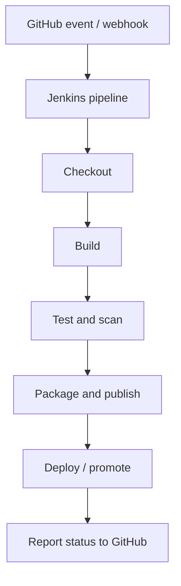

### 9.4 Controller and agents

The lesson introduces a common Jenkins setup:

- **Controller:** coordinates jobs, schedules work, and manages pipeline execution.
- **Agents:** machines or environments that execute build steps.

Teams can use temporary agents on cloud VMs or Kubernetes to isolate and scale build workloads.

### 9.5 Jenkins credentials and plugins

- **Credentials:** store secrets such as tokens and passwords in Jenkins Credentials or an external secrets manager. Do not hard-code secrets in a Jenkinsfile.
- **Plugins:** extend Jenkins to integrate with tools and services. Use a small, carefully maintained set of plugins rather than installing everything.
- **Shared Libraries:** let teams reuse common pipeline code across repositories.

### 9.6 What Jenkins is not

Jenkins is not:

- A Git hosting platform.
- A container registry.
- A monitoring platform.
- A replacement for the application itself.

It orchestrates other tools; it does not replace them.

Alternatives and complements mentioned in the lesson include GitHub Actions, GitLab CI, Argo CD, and Flux. Jenkins can also work with GitOps tools by creating configuration changes that those tools deploy.

---

## 10. End-to-end example: loan repayment feature

Let's connect the entire lesson to one realistic example.

A developer adds a loan repayment feature to an online banking application.

1. **Git:** the developer creates `feature/loan-repayment` and commits the code.
2. **PR:** the developer opens a PR into the target branch.
3. **CI:** Jenkins checks out the proposed code, builds it, runs unit tests, and reports the result.
4. **Review:** the team reviews the changes. A failed check blocks merging until fixed.
5. **Merge:** the approved PR is merged into the protected branch.
6. **Build once:** the pipeline creates a Docker image and publishes it to a registry.
7. **Digest:** the pipeline records the immutable image digest in a promotion manifest.
8. **Dev:** deploy the image and perform smoke/health checks.
9. **Stage:** promote the same digest, run broader integration and end-to-end tests.
10. **Production:** obtain required approval, roll out cautiously, watch health indicators, and roll back if necessary.
11. **Monitoring:** metrics, logs, and traces help the team understand how the feature behaves for real users.

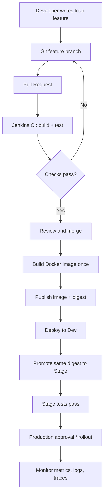

---

## 11. Quick revision sheet

| Question | Short answer |
| --- | --- |
| What is Git? | A distributed version control system |
| What is a commit? | A saved snapshot of changes |
| What is a branch? | A separate line of development |
| What is a PR? | A proposal to merge changes, with review and checks |
| What is CI? | Automatically build and validate code changes |
| What is CT? | Testing across the delivery lifecycle |
| What is Continuous Delivery? | Keep software ready to release, commonly with production approval |
| What is Continuous Deployment? | Automatically release passing changes to production |
| What is CM? | Observe the running system and act on signals |
| What is GitFlow? | A workflow using environment/release branches |
| What is trunk-based development? | A workflow centered on one long-lived main branch |
| What is an artifact? | A build output that can be stored and deployed |
| What is a digest? | A content-addressed identifier for an image |
| Why build once? | So every environment uses the same tested artifact |
| What is Jenkins? | An automation server that runs pipelines |
| What is a Jenkinsfile? | Pipeline definition stored as code in the repository |

## 12. Practical learning checklist

These are suggested exercises to reinforce the lesson. They are **not marked as completed**; record your actual results after trying them.

- [ ] Create a small local Git repository.
- [ ] Make a commit and inspect its history.
- [ ] Create a feature branch and make a separate change.
- [ ] Push the branch to a remote repository.
- [ ] Open a test PR and inspect its review/checks interface.
- [ ] Draw or explain the difference between GitFlow and trunk-based development.
- [ ] Explain why the same image digest should be promoted across environments.
- [ ] Identify where Jenkins would trigger, build, test, publish, and deploy.
- [ ] If the course has reached Jenkins hands-on work, practise the relevant pipeline only after following the tutorial's setup instructions.

### Useful Git commands to understand

```bash
# Create a new local repository
git init

# Check the current working tree
git status

# Stage a file
git add README.md

# Save a snapshot
git commit -m "Add loan repayment notes"

# Create and switch to a feature branch
git switch -c feature/loan-repayment

# See local branches
git branch

# Show recent commits
git log --oneline

# Add a remote (replace with your own repository URL)
git remote add origin https://github.com/USERNAME/REPOSITORY.git

# Push the current branch and set its upstream
git push -u origin feature/loan-repayment
```

These commands are for learning Git. They do not install Jenkins or deploy an application.

## 13. What to document after your own practice

When you perform the exercises, add your own evidence:

- Screenshot of the local repository and branch.
- Screenshot of the GitHub PR and its checks, if you create one.
- Terminal output showing the commits and branches.
- A short explanation of what you expected and what actually happened.
- Any error you encountered and how you resolved it.

Do not claim a lab succeeded unless you ran it and verified the result.

## 14. References

1. [Jenkins Pipeline documentation](https://www.jenkins.io/doc/book/pipeline/) — pipeline-as-code and Jenkinsfile.
2. [Pro Git book](https://git-scm.com/book/en/v2) — Git fundamentals and branching.
3. [Trunk-Based Development](https://trunkbaseddevelopment.com/) — short-lived branches and frequent integration.
4. [Open Container Initiative Image Specification](https://github.com/opencontainers/image-spec) — image digests and content-addressed images.
5. [Kubernetes Deployments](https://kubernetes.io/docs/concepts/workloads/controllers/deployment/) — deployment updates and rollbacks.
6. [Google SRE Book: Service Level Objectives](https://sre.google/sre-book/service-level-objectives/) — SLOs and release guardrails.

---

**Day 2 learning status:** Notes prepared. Update your personal study/lab progress only after you have completed the lesson and any practical work you intend to record.
