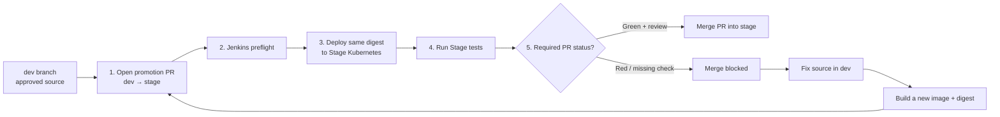
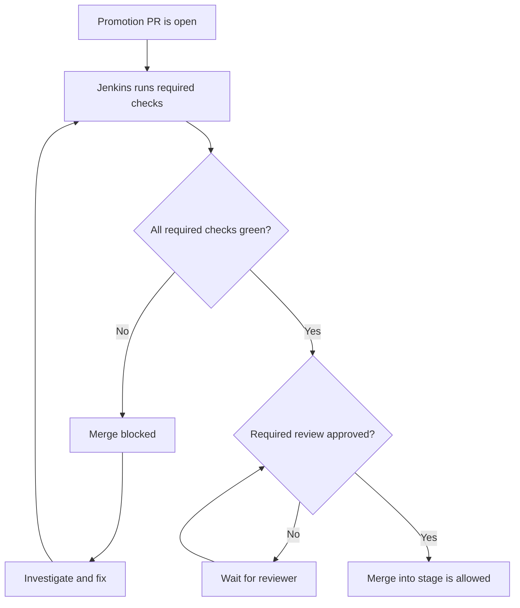
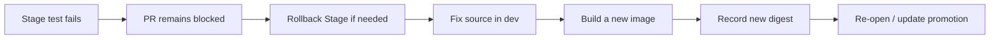

# Demo — Promote a Release from Dev to Stage (Deploy Before Merge)

> Companion to [Day 2 — CI/CD Explained](README.md). This walkthrough explains the Stage-promotion whiteboard shown in the lesson. The names, registry, digest, cluster, and commands are illustrative; they are not a live Acme Bank environment.

## 1. The company situation

Imagine **Acme Bank** is preparing version `v1.4.3` of its loan-repayment service.

The development team has already merged the feature into the `dev` branch and built a container image. Before customers can use it, the release engineer wants to test that exact image in the shared **Stage Kubernetes environment**.

The important rule is:

**Do not rebuild for Stage. Promote the exact image that was already built and tested.**

Why? If the team builds again for Stage, it might produce a different image from the one tested in Dev. Deploying by immutable digest makes the release candidate traceable.

## 2. Read the flow from left to right



The PR is opened first, but the `stage` branch is not merged yet. Jenkins deploys the candidate to the Stage environment while the promotion PR is still open. This is the **deploy-before-merge** pattern.

## 3. What happened before this screenshot?

The Dev build has already:

1. Built the loan service container image once.
2. Pushed it to a registry.
3. Captured the registry digest.
4. Published a `manifest.json` file containing release metadata.

Example image and digest:

```text
Image:  ghcr.io/acme/banking-loans
Tag:    9f3c2e7-v1.4.3
Digest: sha256:abc123...
```

A tag is a readable label. A digest identifies the exact image content. The shortened digest above is only a teaching placeholder, not a valid deployable digest.

## 4. The manifest is the release hand-off note

Example `manifest.json`:

```json
{
  "image": "ghcr.io/acme/banking-loans",
  "digest": "sha256:abc123...",
  "version": "v1.4.3",
  "commit_sha": "9f3c2e7",
  "tags": ["v1.4.3", "9f3c2e7-v1.4.3"],
  "built_at": "2025-09-15T10:22:00Z"
}
```

Think of this manifest as the shipping label on a sealed package. It tells the Stage deployment job:

- Which image repository to use.
- Which exact digest to deploy.
- Which release version and source commit produced it.
- When the image was built.

The Stage job reads this metadata. It must not compile the application or build another image.

## 5. Step 1 — Open a promotion PR

The release engineer opens a pull request:

```text
Source: dev
Target: stage
Purpose: Promote loan service v1.4.3 to Stage
```

This PR is a controlled request to promote a release candidate. Opening it triggers the Stage validation pipeline.

**Company example:** The release engineer is asking the team, “Can we put the exact build from Dev into our Stage environment and prove it is safe to promote?”

## 6. Step 2 — Preflight checks (before deployment)

Jenkins performs checks before changing the Stage cluster.

| Check | Plain-language meaning | Acme Bank example |
|---|---|---|
| Manifest reachable | Can Jenkins read the release metadata? | Download `manifest.json` successfully |
| Image pullable by digest | Is the exact image available? | Registry and cluster can access the digest |
| Configuration renders | Is the Stage configuration valid? | Helm can render the chart with Stage values |
| Kubernetes dry run | Will Kubernetes accept the resources? | Server-side validation succeeds |

A Helm rendering check could look like this:

```bash
helm template loans ./charts/loans \\
  --set image.repository="ghcr.io/acme/banking-loans" \\
  --set image.digest="sha256:abc123..." \\
  -f charts/loans/values-stage.yaml
```

This renders the Kubernetes manifests locally; it does not deploy them. A real pipeline must also have the required registry credentials, cluster access, chart, and values file.

**If a preflight check fails:** stop. Do not deploy a release candidate that cannot be verified.

## 7. Step 3 — Deploy to Stage without rebuilding

The deployment job reads the image and digest from the manifest:

```bash
IMAGE=$(jq -r '.image' manifest.json)
DIGEST=$(jq -r '.digest' manifest.json)

helm upgrade --install loans ./charts/loans \\
  --set image.repository="$IMAGE" \\
  --set image.digest="$DIGEST" \\
  -f charts/loans/values-stage.yaml
```

The intended image reference is:

```text
ghcr.io/acme/banking-loans@sha256:abc123...
```

Notice what changes and what stays the same:

| Item | Dev vs Stage |
|---|---|
| Application image digest | **Same** |
| Application source/build | **Same already-built artifact** |
| Environment values | Can differ (replicas, resources, hostnames, endpoints, etc.) |
| Secrets and configuration | Supplied for the target environment; never baked into the image |

The screenshot's `helm upgrade --install` command is an example of deploying the chart. It assumes Helm, a working Kubernetes context, the chart directory, and the Stage values file are already configured.

## 8. Step 4 — Post-deployment tests

A successful Kubernetes rollout does not prove that the banking feature works correctly. Acme Bank therefore runs checks against the live Stage service.

| Test | What it asks | Example |
|---|---|---|
| Smoke / health | Is the service alive and ready? | Readiness probe and health endpoint succeed |
| Version check | Is the intended release running? | `/version` reports `v1.4.3` and commit `9f3c2e7` |
| Small integration test | Do key services communicate? | Create a test repayment and retrieve it |

Only run tests that are safe for the shared Stage data and dependencies. Do not use real customer transactions.

## 9. Step 5 — PR status decides whether merge is allowed

Jenkins reports the result of each required check to the Git hosting platform. The `stage` branch is protected by repository rules.

Example required statuses:

- `preflight-manifest`
- `preflight-config`
- `deploy-to-stage`
- `stage-smoke`
- `stage-integration`



**Green does not mean “merge automatically” in every company.** It means the required automated checks passed. Required human reviews and other branch rules must also be satisfied.

## 10. What happens when a test fails?

Imagine the integration test discovers that the repayment record is not saved correctly.

1. The integration check reports failure (red).
2. The promotion PR remains blocked.
3. If the Stage environment is unhealthy, the team rolls it back to the last known-good release.
4. Developers fix the application source in Dev.
5. The build pipeline builds and publishes a **new image**.
6. The new digest is recorded in the manifest.
7. The team repeats the promotion process with the new digest.



Do not manually patch the running container and pretend the original artifact is still the tested release. Fix the source, create a new artifact, and promote that artifact through the same checks.

## 11. Screenshot label glossary

| Label on the lesson whiteboard | What it means |
|---|---|
| Promotion PR: `dev → stage` | Request to promote the Dev release candidate |
| PR opens → CI runs | Opening/updating the PR starts the promotion workflow |
| Preflight | Checks before the Stage environment is changed |
| Deploy (no rebuild) | Install the already-published image using its digest |
| Stage environment | The Kubernetes environment used for pre-production validation |
| Post-deploy | Health, version, smoke, and integration checks after rollout |
| PR Status | Combined result of required pipeline checks |
| Green → Merge enabled | Required checks (and review rules) are satisfied |
| Red → Merge blocked | A required condition failed or is still pending |
| Fix in dev → new digest → re-promote | Correct source and create a new immutable release candidate |

## 12. What you should be able to explain

Before moving on, try answering these in your own words:

1. Why does the Stage pipeline use a digest instead of rebuilding the image?
2. Why is the PR still open while the Stage deployment is running?
3. What is the difference between a preflight check and a post-deployment test?
4. Why can a green pipeline still require a human approval?
5. If Stage testing fails, why do we build a new digest after fixing the source?

### Key takeaway

**Open promotion PR → preflight → deploy the same digest → test Stage → merge only when required checks and reviews pass.**

This is a controlled release gate: the company tests the release candidate in Stage before allowing the promotion to become part of the `stage` branch.
