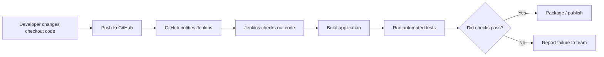
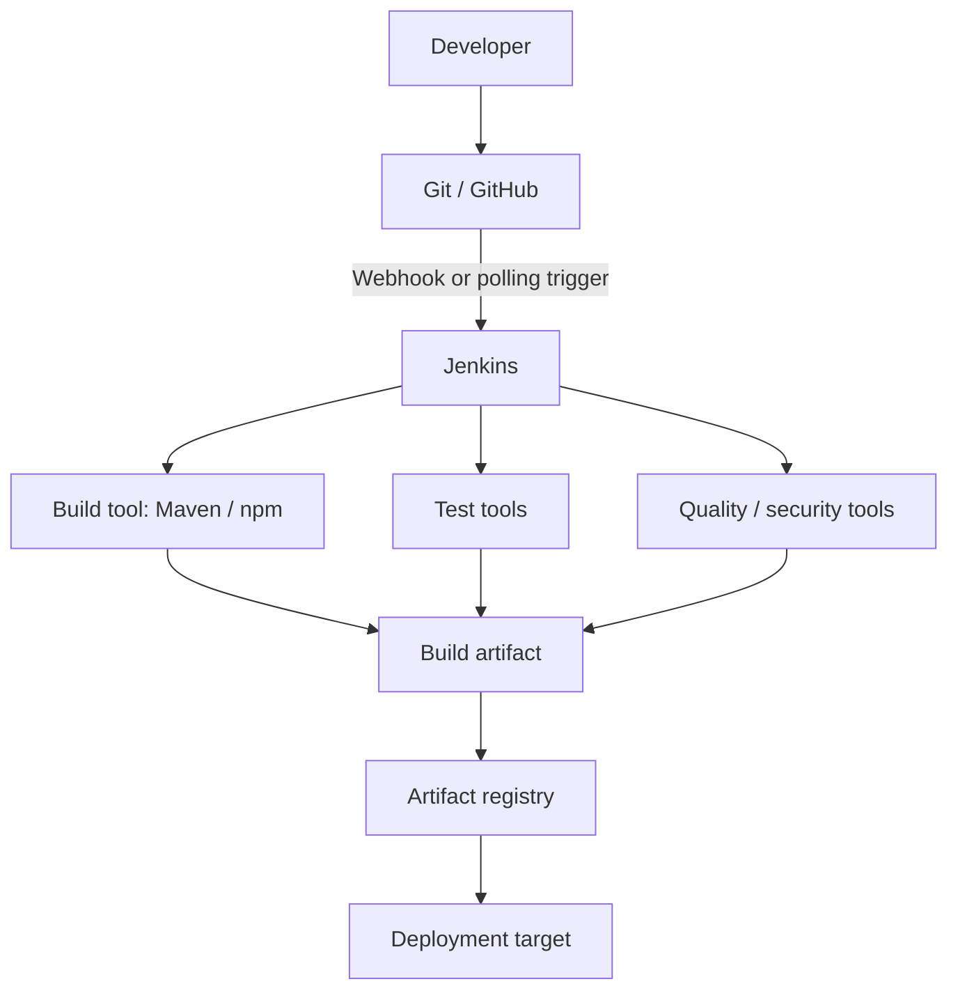
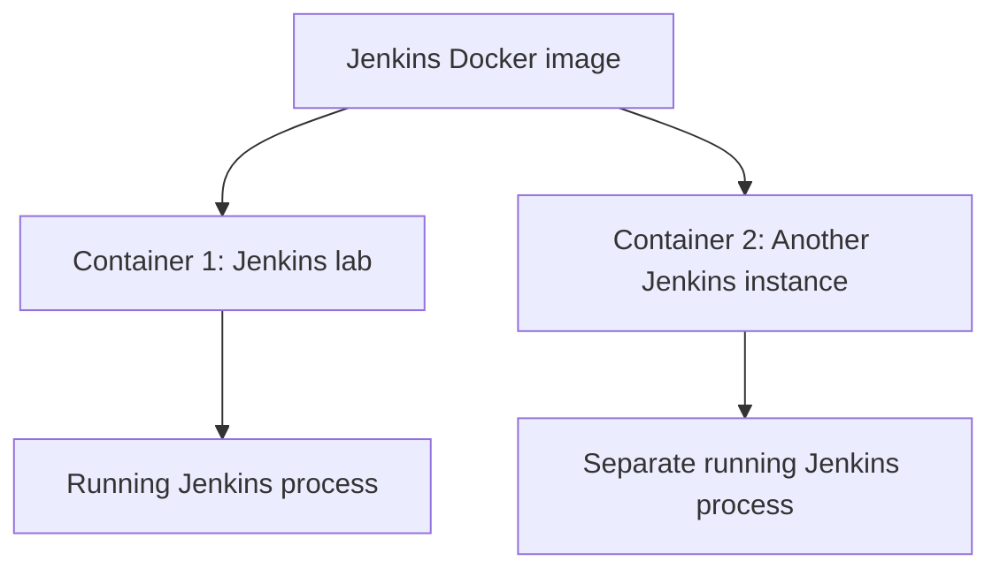
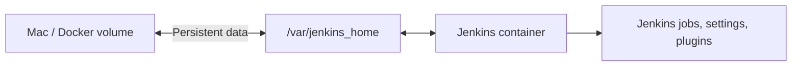

# Day 3 — Jenkins Basics & Installation

> A visual, beginner-friendly learning guide for Day 3 of **Jenkins: Basics to Production** by Josh (Cloud with Josh / Precode Camp). The goal is to understand why Jenkins exists, how it fits into a real software team, and how to run it with Docker when ready.

**Course:** [Jenkins: Basics to Production — Day 3 starts here](https://www.youtube.com/watch?v=uHNOqKdqQas&t=8806s)  
**Topics:** Jenkins fundamentals • installation choices • Docker lab • Jenkins responsibilities  
**Learning environment:** macOS / MacBook Air. The Docker lab below is a planned exercise, not a claim that it has already been completed.

> **Learning rule:** A command in these notes is an instruction, not proof that it ran successfully. Add your own terminal output and screenshots after performing the lab.

---

## Day 3 at a glance

| Course timestamp | Lesson | Main outcome |
|---|---|---|
| [02:26:46](https://www.youtube.com/watch?v=uHNOqKdqQas&t=8806s) | Jenkins Basics & Installation | Understand today's scope |
| [02:27:28](https://www.youtube.com/watch?v=uHNOqKdqQas&t=8848s) | What Is Jenkins? | Explain Jenkins in plain language |
| [02:39:40](https://www.youtube.com/watch?v=uHNOqKdqQas&t=9580s) | Installation Options | Compare ways to run Jenkins |
| [02:48:06](https://www.youtube.com/watch?v=uHNOqKdqQas&t=10086s) | Docker Installation Lab | Run and configure Jenkins in Docker |
| [03:14:57](https://www.youtube.com/watch?v=uHNOqKdqQas&t=11697s) | Jenkins Roles & Responsibilities | Understand what Jenkins does |
| [03:15:56](https://www.youtube.com/watch?v=uHNOqKdqQas&t=11756s) | Day 3 Wrap-Up | Review the key ideas |

## 1. Start with a real company problem

Imagine **ShopEase**, an online shopping company. Its developers update the checkout service several times every week.

A change to checkout can affect payments, order creation, inventory, and customer notifications. The team cannot safely rely on someone remembering every release step.

### Before automation

A developer or release engineer may have to:

1. Get the latest source code.
2. Install dependencies.
3. Build the application.
4. Run tests.
5. Package the application.
6. Deploy it to an environment.
7. Check whether it works.

If someone forgets a test or deploys the wrong version, customers may experience failed checkouts.

### With Jenkins

Jenkins can coordinate those repeatable tasks. A code change can trigger a configured job or pipeline that checks out the code, builds it, runs tests, and reports the result.



**The important idea:** Jenkins is the automation coordinator. The team defines the workflow; Jenkins executes it. Jenkins does not magically know how to build every application.

## 2. What is Jenkins?

**Jenkins is an open-source automation server used to automate software development tasks**, especially continuous integration and continuous delivery (CI/CD).

In simple words: Jenkins is a tool that can run the steps a developer or operations team would otherwise repeat manually.

### Everyday analogy: a restaurant order system

Imagine a restaurant receives an online order. The order system sends the request to the kitchen, the kitchen follows its process, and the system reports whether the order is ready.

Jenkins works in a similar coordinating role for software:

| Restaurant | Software delivery |
|---|---|
| Customer places an order | Developer pushes a code change |
| Order reaches the kitchen | Git event reaches Jenkins |
| Kitchen follows recipe steps | Jenkins runs configured build steps |
| Food is checked before serving | Automated tests validate the application |
| Order is served or sent back | Artifact is delivered, or failure is reported |

Jenkins is not the application, Git repository, or container registry. It coordinates work between them.

### Jenkins in the CI/CD toolchain



**Example:** ShopEase stores source code in GitHub, uses Jenkins to automate the workflow, Maven to build a Java service, Docker to package it, and a container registry to store the image. Each tool has its own responsibility.

## 3. What can Jenkins automate?

| Responsibility | What it means | ShopEase example |
|---|---|---|
| Source checkout | Get a particular revision from Git | Fetch the checkout-service commit |
| Build | Turn source code into a usable build output | Compile the Java service with Maven |
| Testing | Run automated checks | Test tax and payment calculations |
| Quality checks | Check code quality and standards | Run a configured static-analysis tool |
| Packaging | Prepare a deployable artifact | Build a Docker image |
| Publishing | Store the artifact in a registry | Push an image to Amazon ECR |
| Deployment | Release the artifact to an environment | Deploy to a test environment |
| Notifications | Tell people whether a run succeeded | Report a failed checkout test |

Not every Jenkins installation performs every task. The team's pipeline, credentials, installed tools, permissions, and infrastructure determine what it can do.

## 4. How does Jenkins get triggered?

A trigger is an event or schedule that tells Jenkins to start a job or pipeline.

Common examples:

- **Webhook:** GitHub sends Jenkins a notification when a relevant event occurs, such as a push or pull request update.
- **Polling:** Jenkins periodically checks the repository for changes.
- **Scheduled build:** Jenkins runs at a configured time, such as every night.
- **Manual trigger:** A team member starts a job from Jenkins.

### Scenario: a checkout bug fix

A developer fixes a bug in the checkout service and pushes a commit. GitHub sends a webhook to Jenkins. Jenkins starts the configured pipeline and reports the result.

```mermaid
sequenceDiagram
    participant Dev as Developer
    participant GH as GitHub
    participant J as Jenkins
    participant Team as Team
    Dev->>GH: Push bug-fix commit
    GH->>J: Webhook event
    J->>J: Checkout, build, test
    alt Tests pass
        J->>GH: Report success
        J->>Team: Build succeeded
    else Tests fail
        J->>GH: Report failure
        J->>Team: Build failed; inspect logs
    end
```

**Webhook vs polling:** A webhook is like the doorbell ringing when a visitor arrives. Polling is like checking the front door every few minutes to see whether someone is there. Webhooks can provide faster event-driven feedback; polling is useful when a webhook cannot be configured.

## 5. Jenkins installation options

Jenkins can run in different environments. The best choice depends on whether you are learning locally, testing a setup, or operating a shared production service.

| Option | What it means | Good for | Things to consider |
|---|---|---|---|
| Local installation | Install Jenkins directly on a computer | Learning and simple experiments | Java/runtime setup, local machine resources, upgrades |
| Docker container | Run Jenkins as a container | Repeatable local labs and isolated setup | Persistent storage, ports, Docker access, backups |
| Virtual machine (VM) | Run Jenkins on a VM such as an AWS EC2 instance | Remote access and server-like practice | OS maintenance, networking, security, cost |
| Kubernetes / container platform | Run Jenkins on managed or self-managed container infrastructure | Larger or platform-oriented deployments | More operational complexity, storage, upgrades, security |
| Enterprise / managed architecture | Operate Jenkins with durable storage, access controls, backups, agents, and monitoring | Shared team or organizational use | High availability design, governance, maintenance |

### Which option should a beginner understand first?

For a local learning lab, Docker is useful because it packages Jenkins and its runtime environment together. You can start and stop the container without installing Jenkins directly into macOS.

This does **not** mean Docker automatically makes Jenkins production-ready. A production setup needs durable storage, secure access, backups, updates, and a plan for build workloads.

## 6. Docker concepts needed for the Jenkins lab

Before running Jenkins in Docker, understand these four terms:

| Term | Beginner explanation | Example |
|---|---|---|
| Image | A packaged template used to create a container | The official Jenkins LTS image |
| Container | A running instance created from an image | Your running Jenkins server |
| Port mapping | Connect a port on your Mac to a port inside the container | Mac port 8080 → container port 8080 |
| Volume | Persistent storage mounted into a container | Keep Jenkins settings when the container is replaced |

### Image vs container

Think of a Docker image as a recipe or template, and a container as the actual meal prepared from that recipe. You can create multiple containers from one image.



### Why does Jenkins need a volume?

Jenkins stores important information such as jobs, configuration, plugins, and credentials-related configuration under **JENKINS_HOME**.

If that data exists only in a disposable container's writable layer, removing the container can remove the data with it. A persistent volume keeps the data outside the container lifecycle.



**Real-life example:** The container is like a rented office room; the volume is the locked filing cabinet you keep when you move to another room. Replacing the container should not mean losing your Jenkins configuration.

## 7. Practical lab — run Jenkins using Docker

> Follow the exact course demonstration alongside this guide. The commands below show a standard local Docker approach. Check the current official Jenkins Docker instructions and the course's chosen image/tag before running them.

### Step 1 — Check Docker is available

Open Terminal on macOS:

```bash
docker --version
docker info
```

- `docker --version` prints the installed Docker CLI version.
- `docker info` checks whether the Docker engine is reachable.
- If Docker Desktop is not installed or running, these commands may fail. Do not continue until Docker is available.

### Step 2 — Create persistent storage

```bash
docker volume create jenkins_home
```

This creates a named Docker volume. Jenkins data can remain in this volume when a container is stopped or replaced.

### Step 3 — Run the Jenkins LTS container

A common local learning configuration is:

```bash
docker run -d \
  --name jenkins-lts \
  -p 8080:8080 \
  -p 50000:50000 \
  -v jenkins_home:/var/jenkins_home \
  jenkins/jenkins:lts
```

What each option means:

| Option | Meaning |
|---|---|
| `-d` | Run the container in the background |
| `--name jenkins-lts` | Give the container a readable name |
| `-p 8080:8080` | Map Mac port 8080 to Jenkins web port 8080 in the container |
| `-p 50000:50000` | Map the inbound agent port used by some agent configurations; not needed for every setup |
| `-v jenkins_home:/var/jenkins_home` | Store Jenkins data in the named volume |
| `jenkins/jenkins:lts` | Use the Jenkins LTS image tag |

**Port reminder:** Port mapping is written as HOST:CONTAINER. In this example, open the Jenkins web interface on your Mac at [http://localhost:8080](http://localhost:8080).

If port 8080 is already in use, stop and investigate the conflict or choose another host port, for example `-p 8081:8080`; then open `http://localhost:8081`.

### Step 4 — Check the container

```bash
docker ps
docker logs jenkins-lts
```

- `docker ps` lists running containers.
- `docker logs jenkins-lts` displays Jenkins startup output.
- Wait for Jenkins to finish starting before opening the browser.

### Step 5 — Retrieve the initial administrator password

For the standard official Jenkins image setup, the initial password can be read from the container:

```bash
docker exec jenkins-lts cat /var/jenkins_home/secrets/initialAdminPassword
```

Copy the password into the Jenkins setup screen. **Do not publish this password in GitHub, screenshots, notes, or chat.** Treat it as a secret.

### Step 6 — Complete the first-time setup

1. Open [http://localhost:8080](http://localhost:8080).
2. Enter the initial administrator password.
3. Follow the setup wizard.
4. Install the suggested plugins for the initial learning setup, unless the course instructor specifies another selection.
5. Create an administrator account with a strong password.
6. Confirm that the Jenkins dashboard loads.

The exact wizard screens and plugin suggestions can change between Jenkins versions.

### Step 7 — Verify the lab

A successful local setup should let you:

- Open the Jenkins dashboard in your browser.
- Sign in using the administrator account you created.
- See the Jenkins UI without a startup error.
- Confirm the named container is running with `docker ps`.
- Confirm Jenkins data is mounted to the named volume.

Do not mark the lab complete until you have checked these items yourself.

### Container lifecycle commands

```bash
# Stop Jenkins without deleting its data
docker stop jenkins-lts

# Start the existing container again
docker start jenkins-lts

# Follow startup logs
docker logs -f jenkins-lts

# List containers, including stopped ones
docker ps -a

# Remove the container (the named volume remains unless you delete it)
docker rm -f jenkins-lts

# List Docker volumes
docker volume ls
```

**Important:** Do not run `docker volume rm jenkins_home` unless you intentionally want to delete the Jenkins data stored in that volume. Removing a container and deleting its volume are different actions.

## 8. Jenkins roles and responsibilities

Jenkins is responsible for orchestrating configured automation. It does not replace every tool in a delivery system.

| Jenkins responsibility | What Jenkins does | What another tool may do |
|---|---|---|
| Coordinate a workflow | Starts and sequences pipeline stages | GitHub hosts source code |
| Run build steps | Invokes configured commands | Maven compiles a Java project |
| Run tests | Executes configured test commands | JUnit or another framework performs tests |
| Package software | Runs packaging commands | Docker builds a container image |
| Store artifacts | Can invoke upload/publish steps | ECR, Docker Hub, or another registry stores images |
| Deploy software | Runs deployment commands or invokes deployment tools | Kubernetes or another platform runs workloads |
| Report results | Publishes build status and logs | Monitoring tools observe the running service |

### Real-life release scenario

ShopEase is preparing a new checkout release:

1. GitHub stores the code and receives the developer's push.
2. Jenkins starts the pipeline.
3. Jenkins runs Maven to build the Java application.
4. Jenkins runs tests.
5. Jenkins invokes Docker to create an image.
6. Jenkins pushes the image to a registry such as Amazon ECR.
7. A deployment step releases the image to the target environment.
8. The team checks application health and monitoring signals.

Jenkins coordinates these steps, but Maven, Docker, the registry, and deployment platform each perform their own jobs.

## 9. Common beginner mistakes and troubleshooting

| Symptom | Possible reason | What to check |
|---|---|---|
| Browser cannot open localhost:8080 | Container is stopped or Jenkins is still starting | `docker ps -a`, then `docker logs jenkins-lts` |
| Docker command cannot connect | Docker Desktop / engine is not running | Open Docker Desktop and check `docker info` |
| Port is already allocated | Another process uses host port 8080 | Choose a free host port, e.g. 8081 |
| Jenkins asks for initial password again | Setup is not completed or data volume differs | Confirm the correct container and mounted volume |
| Jenkins setup disappears after replacing container | Data was not stored persistently | Confirm the volume mount to `/var/jenkins_home` |
| Container exits | Startup/configuration error or resource issue | Inspect `docker logs jenkins-lts` |

**Good troubleshooting habit:** Read the error first, inspect container status and logs, and change one thing at a time. Avoid deleting the Jenkins volume as a first troubleshooting step.

## 10. Security and production notes

A local learning container is not automatically a secure production Jenkins service.

For a real team, consider:

- Restrict access to the Jenkins UI; do not expose it publicly without appropriate protection.
- Use strong authentication and role-based permissions.
- Store tokens and passwords in Jenkins Credentials or a suitable secrets manager, not in source code.
- Keep Jenkins core and plugins updated.
- Back up JENKINS_HOME and test that backups can be restored.
- Use dedicated agents for build workloads where appropriate.
- Limit the permissions available to jobs and agents.
- Protect the Docker socket: access to it can provide powerful control over the host.
- Use HTTPS and secure network access for shared installations.

**Remember:** A successful local lab proves that Jenkins can run in your learning environment. It does not prove that the setup is production-hardened.

## 11. Quick revision sheet

| Question | Short answer |
|---|---|
| What is Jenkins? | An open-source automation server |
| Why do teams use Jenkins? | To automate repeatable build, test, package, and delivery tasks |
| What is a trigger? | An event or schedule that starts a job or pipeline |
| What is a webhook? | An event notification sent from one system to another |
| What is polling? | Checking a repository periodically for changes |
| What is a Docker image? | A template used to create containers |
| What is a container? | A running instance created from an image |
| What is port mapping? | Connecting a host port to a container port |
| What is a Docker volume? | Persistent storage that exists separately from a container |
| What is JENKINS_HOME? | Jenkins' data directory for configuration, jobs, plugins, and related state |
| Does Jenkins replace GitHub? | No. GitHub hosts the repository; Jenkins automates workflows |
| Does Jenkins replace Docker? | No. Jenkins can invoke Docker to build or run containers |
| Is a local Docker setup production-ready? | No. Production needs security, backups, maintenance, and reliable infrastructure |

## 12. Practical checklist — record your real progress

These are exercises to attempt, not pre-completed results.

- [ ] Explain Jenkins in your own words without reading the definition.
- [ ] Describe the ShopEase code-change scenario from GitHub push to Jenkins result.
- [ ] Compare local, Docker, VM, and Kubernetes installation approaches.
- [ ] Confirm Docker is installed and its engine is running.
- [ ] Create a named Docker volume for Jenkins.
- [ ] Start the Jenkins container.
- [ ] Open the Jenkins dashboard in the browser.
- [ ] Complete the first-time setup wizard.
- [ ] Stop and start the container and confirm your configuration remains.
- [ ] Explain the difference between an image, container, port mapping, and volume.

### Evidence to add after the lab

When you actually perform the steps, capture screenshots such as:

1. Terminal showing Docker version and engine availability (do not show secrets).
2. Terminal showing the Jenkins container running.
3. Browser showing the Jenkins setup wizard or dashboard (hide sensitive information).
4. Terminal showing the named volume.
5. Jenkins dashboard after sign-in.

For each screenshot, add one sentence explaining **what it proves**. Do not include the initial administrator password, tokens, private keys, or other secrets.

## 13. What I learned today

Use this short template after studying the lesson:

- **Topic I understood:**
- **A concept I found confusing:**
- **Real-world example I can explain:**
- **Practical work I attempted:**
- **What worked:**
- **Error / lesson learned:**
- **Next step:**

## 14. References

1. [Jenkins official documentation](https://www.jenkins.io/doc/) — Jenkins concepts and administration.
2. [Jenkins installation documentation](https://www.jenkins.io/doc/book/installing/) — installation approaches.
3. [Jenkins Docker image](https://hub.docker.com/r/jenkins/jenkins) — official image and usage information.
4. [Jenkins on Docker documentation](https://www.jenkins.io/doc/book/installing/docker/) — Docker-based setup.
5. [Docker volumes documentation](https://docs.docker.com/engine/storage/volumes/) — persistent container data.
6. [Docker port publishing documentation](https://docs.docker.com/engine/network/port-publishing/) — host-to-container port mapping.

---

**Day 3 status:** Learning guide prepared. Update lesson and lab completion only after studying the material and verifying the practical work.
