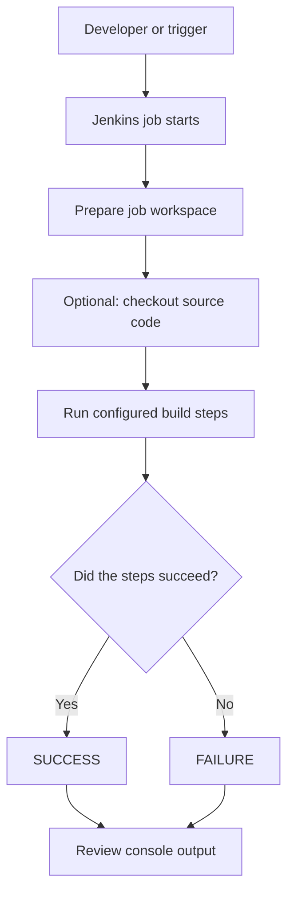
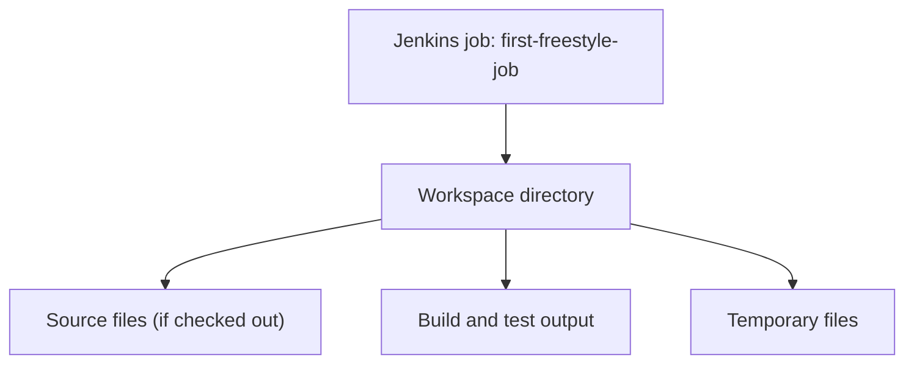
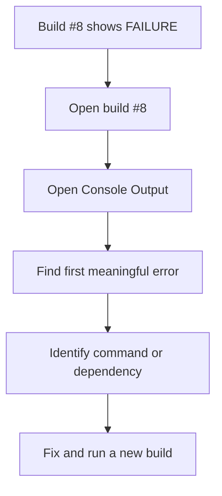
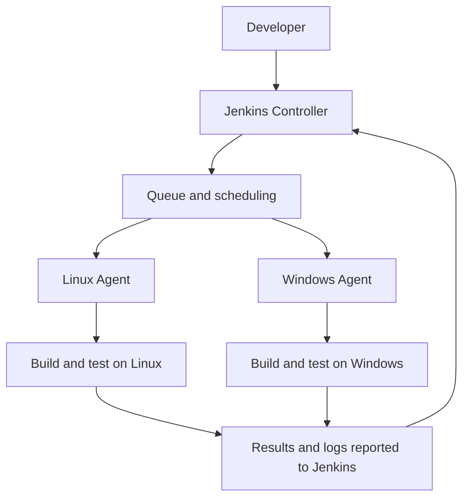

# Day 4 — Jenkins Freestyle Jobs Deep Dive

> Beginner-friendly notes for the **Jenkins Basics to Production** course by Cloud with Josh / Precode Camp. These notes explain the concepts and provide safe practice labs. Complete a lab yourself before marking it as completed.

## Learning objectives

By the end of this section, you should be able to:

- Explain what a Jenkins job and build are.
- Create and run a Freestyle project.
- Use **Execute shell** to automate simple tasks.
- Understand a workspace, build history, console output, and build status.
- Explain what `JENKINS_HOME` stores and why it must be protected and backed up.
- Distinguish the Jenkins controller from an agent.
- Understand where a build command actually runs.
- Diagnose common Freestyle-job failures.

---

## 1. What is a Jenkins job?

A **Jenkins job** is a saved definition of work that Jenkins can perform. It tells Jenkins what to do, when to do it, and (when configured) where to run it.

Think of an online store that receives orders. Every morning, an employee used to manually prepare a sales report. A Jenkins job can run the report script automatically at a scheduled time and save the result.

A job is the *recipe/configuration*. A **build** is one execution of that recipe.

### Job vs. build

| Term | Simple meaning | Example |
| --- | --- | --- |
| Job | Saved instructions | "Generate the daily sales report" |
| Build | One run of those instructions | Report generated on Monday |
| Build number | Jenkins' sequential identifier for a run | Build #12 |
| Workspace | Working directory used for a job run | Files checked out and generated |
| Console output | Log of what happened during the run | Commands and their printed output |

A job can run many times, producing build #1, #2, #3, and so on.

## 2. What is a Freestyle project?

A **Freestyle project** is one of Jenkins' basic job types. You configure it through the Jenkins web interface: source code settings, build triggers, build steps, and post-build actions.

It is useful for learning Jenkins fundamentals and for relatively straightforward automation. For complex, version-controlled delivery workflows, a Pipeline defined in a `Jenkinsfile` is usually more maintainable.

### Real-life scenario

A small development team maintains a Python application. Whenever a developer asks Jenkins to run the job, Jenkins can:

1. Move into the job's workspace.
2. Check out the configured source code (if source control is configured).
3. Run a shell script that prints a message and executes tests.
4. Mark the build successful if the commands succeed, or failed if a command returns a non-zero exit code.

### Basic Freestyle flow



## 3. Create your first Freestyle job

This lab uses a harmless shell script. It does not deploy anything or modify system configuration.

1. Open your Jenkins dashboard.
2. Select **New Item**.
3. Enter the name `first-freestyle-job`.
4. Select **Freestyle project**, then select **OK**.
5. In the job configuration, find **Build Steps**.
6. Select **Add build step → Execute shell** (on a Windows agent, the equivalent is typically **Execute Windows batch command**).
7. Add the script below.
8. Select **Save**.
9. Select **Build Now**.
10. Open the new build in **Build History**, then select **Console Output**.

### First shell script

```bash
echo "Hello from Jenkins!"
echo "This is my first Freestyle build."
echo "Build number: $BUILD_NUMBER"
echo "Job name: $JOB_NAME"
echo "Workspace: $WORKSPACE"
echo "Current directory:"
pwd
echo "Current user:"
whoami
echo "Build date:"
date
```

### Understand each command

| Command / variable | What it does |
| --- | --- |
| `echo` | Prints text to the console log |
| `pwd` | Prints the current working directory |
| `whoami` | Prints the account running the shell process |
| `date` | Prints the machine's current date and time |
| `$BUILD_NUMBER` | Jenkins-provided build number |
| `$JOB_NAME` | Jenkins job name |
| `$WORKSPACE` | Path to this job's workspace |

**Important:** These environment variables are supplied to the build process by Jenkins. They are not universal shell variables outside Jenkins.

### What should you see?

The Console Output should contain the messages and command results. The build should show **SUCCESS** if the shell commands complete successfully. The exact workspace path, user, and date depend on the machine and agent where the build runs.

Example (illustrative output; your values will differ):

```text
Started by user ...
Running as ...
Building in workspace ...
Hello from Jenkins!
This is my first Freestyle build.
Build number: 1
Job name: first-freestyle-job
Workspace: .../workspace/first-freestyle-job
Current directory:
.../workspace/first-freestyle-job
Current user:
...
Build date:
...
Finished: SUCCESS
```

## 4. Understand the workspace

A **workspace** is a job's working directory on the machine (controller or agent) that executes the build. Jenkins uses it for checked-out source code, temporary build files, test output, and other files created during a run.

### Real-life analogy

Imagine a mechanic's workbench. Each repair task needs a place to put the vehicle parts and tools while the work is happening. The Jenkins workspace is that workbench for a job.



Useful shell commands to add to a practice build:

```bash
echo "Workspace path: $WORKSPACE"
pwd
ls -la
```

**Workspace is not the same as `JENKINS_HOME`.** The workspace is job working space; `JENKINS_HOME` is Jenkins' main data directory containing its configuration and other persistent data.

Do not assume a workspace is permanent storage. Workspace cleanup, job configuration, plugins, and agent setup can affect its contents. Store important deliverables in an artifact repository or other durable storage rather than relying on a workspace.

## 5. Build history and console output

**Build History** lists previous executions of a job. Selecting a build lets you inspect its details, such as Console Output, changes (when SCM is configured), and any recorded artifacts or test results.

Common build results:

| Result | Meaning |
| --- | --- |
| SUCCESS | The build steps completed successfully |
| FAILURE | A build step or other required operation failed |
| UNSTABLE | The build completed but a test/reporting condition marked it unstable |
| ABORTED | The build was stopped before normal completion |
| NOT BUILT | The build was not executed |

### Why console output matters

Suppose a test fails. The red status icon tells you that something went wrong; the **Console Output** helps you find where and why. Read from the first meaningful error, not just the final line.



## 6. How does Jenkins decide whether a shell step succeeds?

For a shell build step, Jenkins generally treats an exit code of `0` as success and a non-zero exit code as failure. Shell scripts can therefore communicate whether their work succeeded.

Try this safe example:

```bash
echo "Running a simple check..."
if [ -d "$WORKSPACE" ]; then
  echo "Workspace exists."
else
  echo "Workspace is missing."
  exit 1
fi
echo "Check completed."
```

To understand failure handling, you can deliberately run this in a separate test job:

```bash
echo "This command will return an error status."
exit 1
```

That build should fail. Remove the deliberate failure command before using the job for normal practice.

## 7. What is JENKINS_HOME?

`JENKINS_HOME` is the main data directory Jenkins uses to store its persistent state. It is not simply the folder where the Jenkins application executable lives.

Depending on the installation method and configuration, it can contain:

- Job configurations.
- Build records and logs (subject to retention settings).
- Plugin files and plugin data.
- Jenkins system configuration.
- Credentials and security-related data.
- User and other instance data.

### Typical directory view

The exact files and layout can vary by Jenkins version, plugins, and installation method.

```text
JENKINS_HOME/
├── config.xml             # Main Jenkins configuration
├── jobs/
│   └── first-freestyle-job/
│       ├── config.xml     # Job configuration
│       └── builds/        # Build records (retention-dependent)
├── plugins/               # Installed plugins
├── users/                 # Jenkins user data
├── credentials.xml        # Sensitive credential data may be stored here
└── secrets/               # Sensitive key material
```

### Real-life scenario: why backups matter

Imagine a company has configured dozens of Jenkins jobs, credentials, plugins, and build settings. If the Jenkins host is lost and there is no usable backup, rebuilding the automation environment can take significant time.

A tested backup of the required Jenkins data helps the team recover. Backups must be protected because Jenkins data can contain credentials and secret material.

### Backup and security principles

- Identify the actual `JENKINS_HOME` for your installation; do not guess its path.
- Use a consistent backup approach. For a reliable backup, follow Jenkins guidance for safely capturing data while accounting for active builds and writes.
- Protect backups with strict access controls and encryption at rest.
- Test restoration periodically; an untested backup may not be recoverable.
- Keep secrets out of screenshots, public repositories, and console logs.
- Do not casually delete files inside `JENKINS_HOME`; doing so can break jobs or the Jenkins instance.

## 8. Jenkins Controller vs. Agent

The **controller** is the central Jenkins service. It provides the UI, stores configuration, schedules work, and coordinates agents.

An **agent** is a machine or execution environment that connects to Jenkins and runs assigned build work. Agents can have different operating systems, tools, CPU, memory, and permissions.

### Real-life analogy

Think of a restaurant:

- **Controller = restaurant manager:** receives orders, assigns work, and tracks progress.
- **Agents = kitchen stations/chefs:** perform the assigned work.
- **Build = one order being prepared.**

The manager coordinates the work; the kitchen station performs the cooking.

### Architecture



### Important distinction

- The controller manages Jenkins and coordinates work.
- An agent executes the assigned build steps.
- A job configured to run on the built-in node may execute on the controller itself.
- A job restricted to a label can run on an eligible agent with that label.
- The workspace is on the node that runs the build, not necessarily on the controller.

For production environments, it is generally preferable to avoid running application builds on the controller. Use appropriately configured agents and limit controller executors according to your operational design.

## 9. Where does Execute shell run?

This is an important practical point: **the shell step runs on the node that executes the build**.

If the job runs on the built-in node, the command runs in that node's environment. If it runs on a Linux agent, the command runs on that agent. The installed tools, filesystem paths, permissions, and available environment variables can therefore differ.

For example, a job that runs `docker build` needs access to a Docker CLI and a Docker daemon from its execution environment, with suitable permissions. Installing Docker only on the controller does not automatically make it available on every agent.

## 10. Freestyle job configuration: the main areas

The exact UI can vary slightly by Jenkins version and installed plugins.

| Configuration area | Purpose |
| --- | --- |
| General | Job description and general options |
| Source Code Management | Configure Git or another supported SCM |
| Build Triggers | Decide what event or schedule starts the job |
| Build Environment | Configure supported environment options |
| Build Steps | Commands and actions Jenkins executes |
| Post-build Actions | Actions after build steps, such as archiving artifacts or publishing reports when configured |

### Common ways a job can start

- **Build Now:** a person starts it manually.
- **Build periodically:** a schedule starts it.
- **Poll SCM:** Jenkins checks source control on a schedule for changes.
- **Webhook trigger:** a source-control platform notifies Jenkins about an event, when the required integration and configuration are in place.
- **Upstream/downstream relationship:** another job can trigger this job through configured relationships or steps.

A schedule and source-code polling are not the same: periodic builds run on a schedule whether or not code changed; polling checks for SCM changes.

## 11. Practical exercises

Work through these in Jenkins. They are practice tasks, not claims that they have already been completed.

### Lab 1 — Inspect your build environment

Create a Freestyle job named `inspect-build-environment` and add:

```bash
echo "Job: $JOB_NAME"
echo "Build: $BUILD_NUMBER"
echo "Workspace: $WORKSPACE"
echo "Node name: $NODE_NAME"
echo "Operating system information:"
uname -a
echo "Workspace contents:"
ls -la
```

Run the job and inspect Console Output. Record which node ran the build and the workspace path.

### Lab 2 — Create a report file

Create a job named `daily-report-practice`:

```bash
mkdir -p reports
{
  echo "Practice Build Report"
  echo "Job: $JOB_NAME"
  echo "Build: $BUILD_NUMBER"
  echo "Generated: $(date)"
} > reports/build-report.txt

echo "Report created:"
cat reports/build-report.txt
```

This creates a report inside the job workspace. It is a practice file, not a durable production report.

### Lab 3 — Simulate a validation check

Create a job named `application-validation-practice`:

```bash
echo "Starting application validation..."
test -d "$WORKSPACE" || exit 1
echo "Workspace check passed."

if command -v git >/dev/null 2>&1; then
  echo "Git is available."
else
  echo "Git is not installed on this build node."
  exit 1
fi

echo "Validation completed successfully."
```

This checks the workspace and whether Git is available on the build node. If Git is missing, the job fails with a useful message.

### Lab 4 — Understand build failure

In a separate practice job, run:

```bash
echo "Step 1: starting"
echo "Step 2: simulating a failure"
exit 1
echo "This line will not execute"
```

Inspect the result and console log. Explain why the final line does not run. Then remove `exit 1` and run again.

### Lab 5 — Compare controller and agent

If you have an agent configured:

1. Create or inspect a node label for that agent.
2. Configure a test job to restrict where it can run using that label.
3. Run the job with `echo "$NODE_NAME"`, `pwd`, and `uname -a`.
4. Compare the output with a job running on the built-in node, if permitted.
5. Record the differences.

If you do not have an agent, do not claim this lab is complete. First learn the architecture and perform the lab when an agent is available.

## 12. Common problems and troubleshooting

| Problem | Likely reason | What to check |
| --- | --- | --- |
| Build fails immediately | Shell command returned non-zero | Read Console Output and inspect the first error |
| `command not found` | Tool is not installed or not on PATH on the build node | Check the agent/controller environment |
| Permission denied | Build user lacks permission | Review file ownership and least-privilege permissions |
| Wrong workspace contents | Job ran on a different node or workspace | Check `NODE_NAME` and `WORKSPACE` |
| Git checkout fails | Repository URL, credentials, network, or Git setup issue | Review SCM configuration and safe credential setup |
| Job waits in queue | No eligible executor/agent or node is offline | Check labels, node status, and executor availability |
| Jenkins data missing after recovery | Backup incomplete or wrong home directory restored | Verify configured `JENKINS_HOME` and restore procedure |

Never paste passwords, access tokens, private keys, or credential values into a shell script or public build log. Use Jenkins Credentials and the appropriate credential binding/integration when a lab requires secrets.

## 13. Freestyle vs. Pipeline

| Freestyle project | Pipeline |
| --- | --- |
| Mostly configured through the UI | Commonly defined as code in a `Jenkinsfile` |
| Easy to start learning | Better suited to complex workflows |
| Configuration can be harder to review in Git | Pipeline definition can be version-controlled with the application |
| Good for simple jobs and learning | Supports stages, parallel work, conditions, and reusable patterns |

A Freestyle job is not obsolete. It is a useful way to learn the basic building blocks before moving to Pipeline as Code.

## 14. Interview questions

**Q1. What is a Jenkins job?**  
A saved configuration that defines a task Jenkins can execute.

**Q2. What is a build?**  
One execution of a Jenkins job.

**Q3. What is a Freestyle project?**  
A basic Jenkins job type configured mainly through the Jenkins UI.

**Q4. What is a workspace?**  
The working directory used by a job on the node executing the build.

**Q5. What is JENKINS_HOME?**  
The main data directory containing Jenkins configuration and persistent instance data, including jobs and potentially sensitive information.

**Q6. What is the difference between controller and agent?**  
The controller coordinates Jenkins and schedules work; agents execute assigned build tasks.

**Q7. Where does Execute shell run?**  
On the node assigned to execute that build.

**Q8. What is Console Output used for?**  
It shows the build log, including commands' output and errors, helping diagnose failures.

**Q9. Why back up JENKINS_HOME?**  
To recover important Jenkins configuration and data after loss or corruption. Backups must be protected and restoration tested.

**Q10. When would you choose Pipeline over Freestyle?**  
When the workflow is complex, should be version-controlled as code, or needs reusable stages and more advanced delivery logic.

## 15. Key takeaways

- A **job** is the recipe; a **build** is one run of that recipe.
- A Freestyle project is a UI-configured Jenkins job.
- Build steps such as Execute shell automate work.
- The workspace is the job's working directory.
- Console Output is essential for troubleshooting.
- `JENKINS_HOME` holds important persistent Jenkins data and must be protected.
- The controller coordinates; agents execute assigned work.
- A shell command runs on the node that executes the build.
- Learn Freestyle fundamentals before progressing to Jenkins Pipelines.

## 16. Learning and lab status

Update this section as you work:

- [ ] Watched the Freestyle Jobs lesson.
- [ ] Created a Freestyle project.
- [ ] Ran the first Execute shell build.
- [ ] Inspected Build History and Console Output.
- [ ] Explored the workspace.
- [ ] Understood the purpose of JENKINS_HOME.
- [ ] Understood controller vs. agent.
- [ ] Completed at least one troubleshooting exercise.
- [ ] Captured my own screenshots / terminal evidence.

**Do not tick a box until you have personally completed that activity.**

## Course reference

- [Cloud with Josh / Precode Camp — Jenkins Basics to Production](https://www.youtube.com/watch?v=uHNOqKdqQas)
- [Jenkins User Handbook](https://www.jenkins.io/doc/book/)
- [Jenkins Controller Isolation](https://www.jenkins.io/doc/book/security/controller-isolation/)
- [Jenkins Managing System](https://www.jenkins.io/doc/book/managing/)

---

*Personal learning notes written in my own words. Examples and sample output are illustrative; verify commands and results in your own Jenkins environment.*
